# MC-707 Toolbox

Write songs and play live sets on the **Roland MC-707** from your computer. One USB cable carries all eight tracks, and the app can record the audio that comes back.

- **Song Mode**: arrange a whole track on a timeline, then play it on the MC-707 note for note.
- **Live Mode**: perform a looping set from 16 pads, with breaks, builds, drops, swaps and fades that land on the beat.
- **ZenCore editor**: edit the sound in any of your MC-707's clips on a big screen.

> **Version 1.3.1.** Free to use and share, not for sale (see [Licence](#licence)). An unofficial fan project, not made by or affiliated with Roland.

**Try it:** open the [web version](https://mendo-707.github.io/mc707-toolbox/) in Chrome or Edge, or download the Windows app from [Releases](../../releases).


<details>
<summary><b>More screenshots and a tour in 10 cards</b></summary>

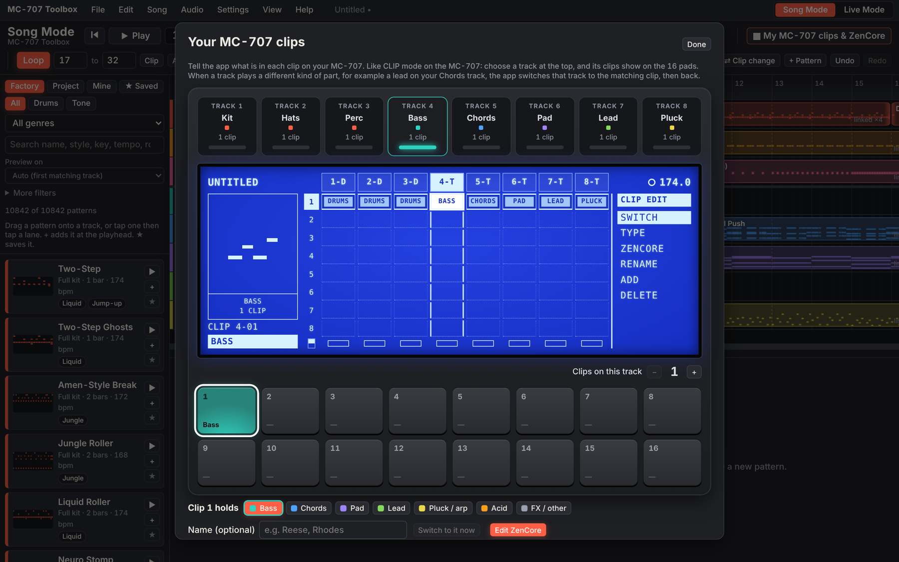
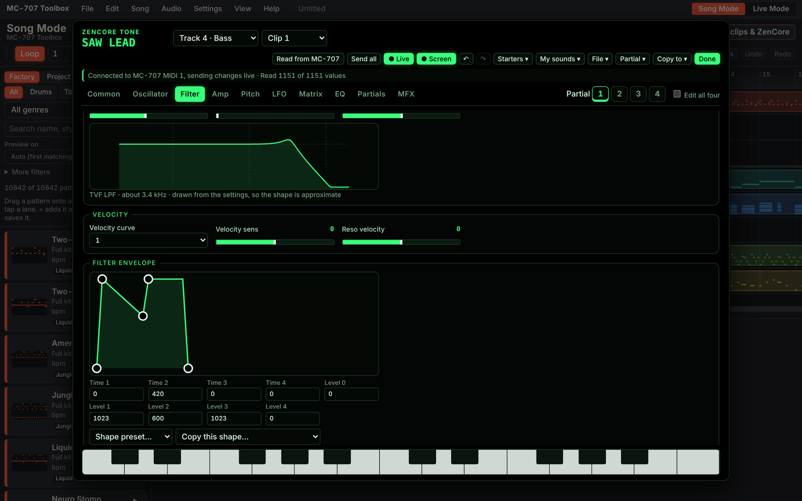

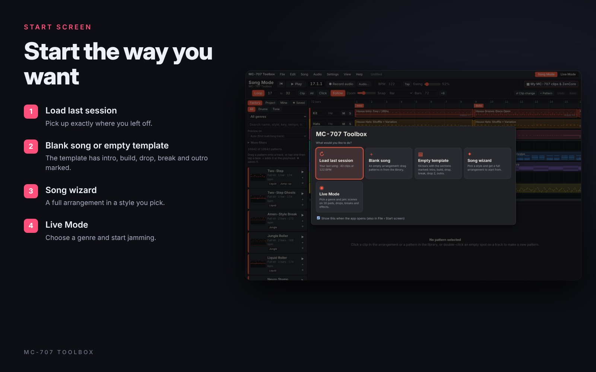
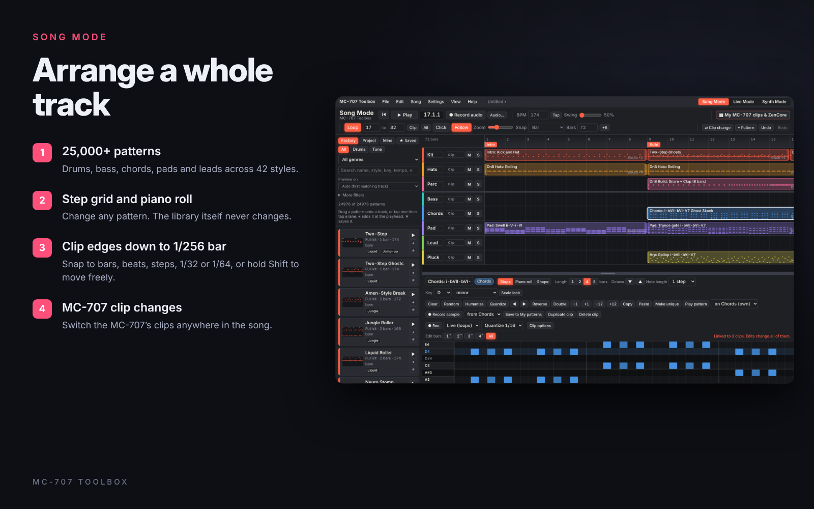
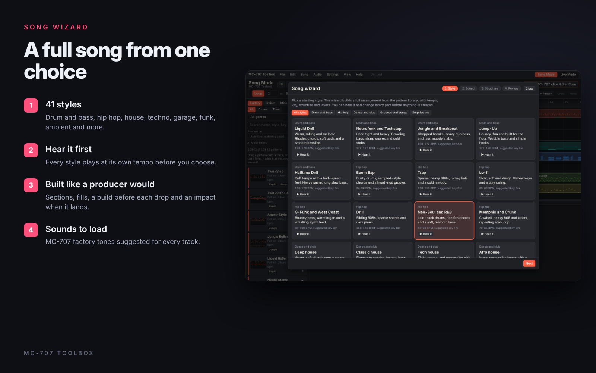
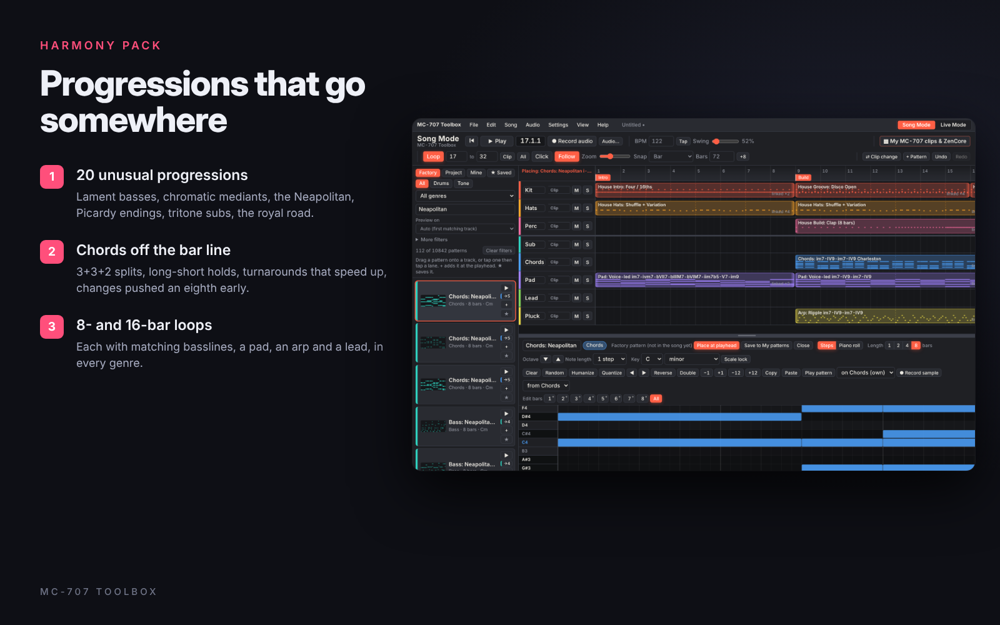
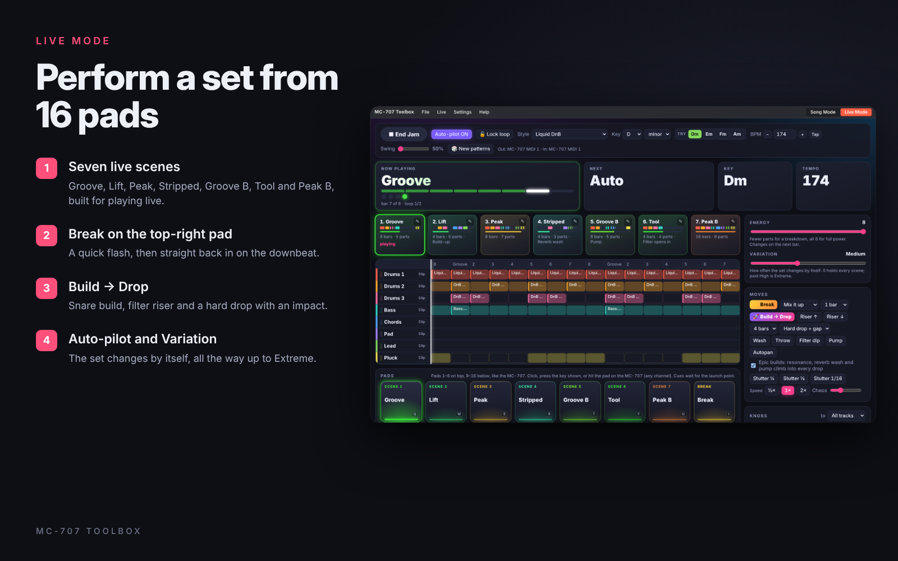
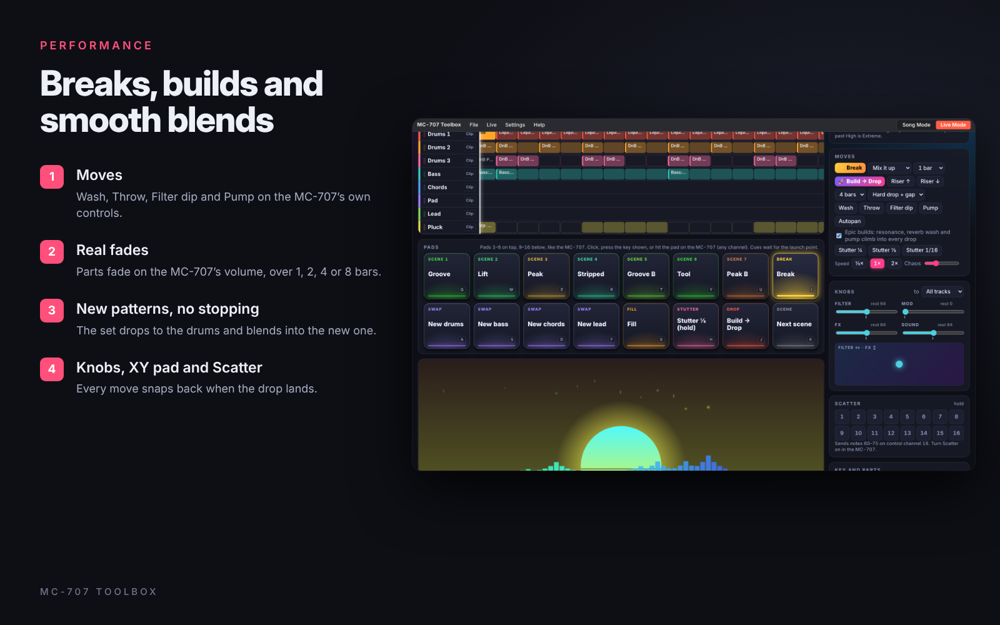
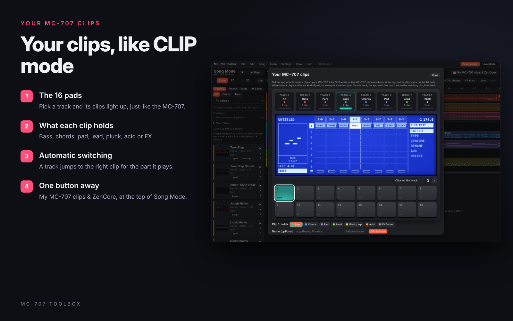
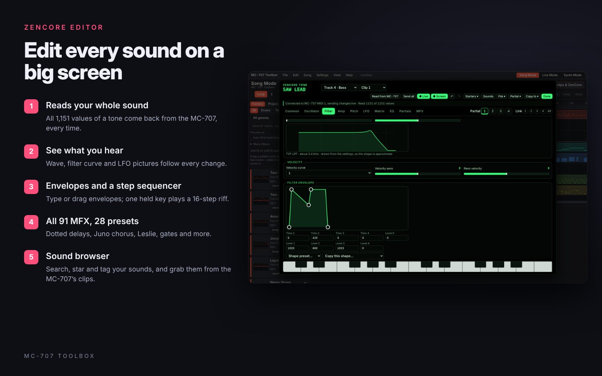
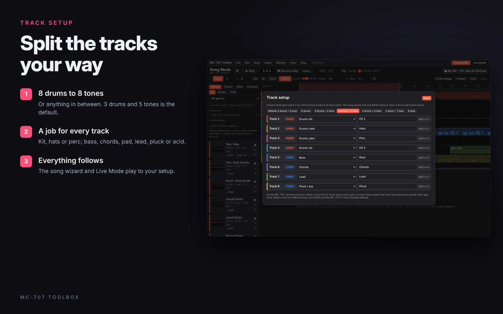
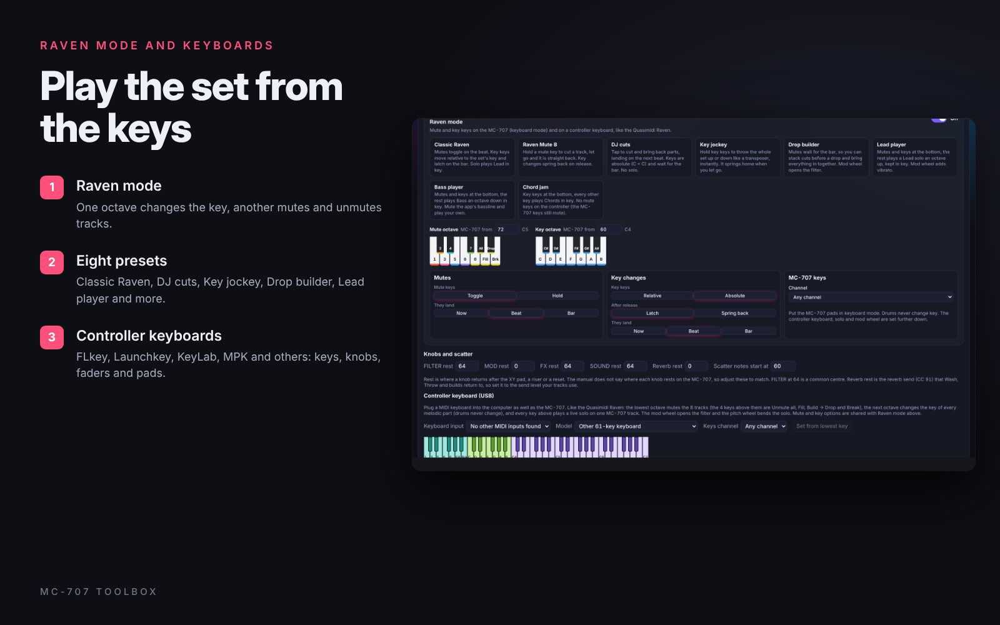

</details>

## New in 1.3

- **Start screen** with Load last session, Blank song, Empty template, Song wizard and Live Mode. Live Mode opens with a genre picker.
- **Track setup**: split the 8 tracks any way you like, from 8 drum tracks to 8 tone tracks.
- **Harmony pack**: 2,000 new patterns on 20 unusual progressions, with chords that change off the bar line, in 8- and 16-bar loops.
- **Finer clip edges** in Song Mode, down to 1/256 bar.
- **Smoother Live fades** on the MC-707's own volume, with new 4- and 8-bar fades.
- **Acid** lines for a tone track, and **My MC-707 clips & ZenCore** at the top of Song Mode.
- ZenCore editor: reads every parameter of a tone reliably (1.3.1 fixes how it asks the MC-707, found from a real dump), the MC-707's screen updates by itself, there's a black-and-green look, and MC-101 support is fixed.
- **Settings › App sounds** turns the app's own sound on or off. Punk and rock are gone.

---

## Getting started

### Windows app (recommended)

Download from [Releases](../../releases):

- **`MC-707-Toolbox-Setup.exe`**: the installer. It adds the app to the Start menu and desktop and opens faster. Install a newer version over the top; your songs, settings and My patterns stay. Uninstall it from Windows **Settings › Apps**.
- **`MC-707-Toolbox.exe`**: the portable app. One file, no install; it runs from anywhere, even a USB stick.

Both keep their work in the same place, so you can switch between them. The first time you open either one, Windows may say *"Windows protected your PC"* because the app isn't code-signed. Click **More info**, then **Run anyway**.

**Build it yourself:** install **Node.js LTS** from <https://nodejs.org>, double-click **`build-exe.bat`** and wait 2–5 minutes. Both files appear in the **`dist`** folder. If the build fails, the details are in `build-log.txt`.

### In a browser

Open the [web version](https://mendo-707.github.io/mc707-toolbox/), or download `index.html` and open it, in **Chrome or Edge**. Everything works except real folders and Save As dialogs, which need the Windows app. Firefox and Safari don't support Web MIDI.

### Connect the MC-707

1. Plug the MC-707 into the computer by USB.
2. Open **Settings › Quick setup** and press **Auto-connect MC-707**.
3. Press **Play tracks 1 → 8**. Each MC-707 track should sound in turn. If one is wrong, change its channel there.
4. On the MC-707 (SHIFT + KNOB ASSIGN › SET › MIDI tab), set **MIDI Rx Auto Channel** to **OFF** and **Track Channel 1-8** to CH1–CH8. Quick setup walks through every setting that matters.
5. Optional: tick **Make the MC-707 follow this app** to send MIDI clock and start/stop. On the MC-707, set sync to AUTO or USB.

---

## Opening the app

The app opens in Song Mode with a **start screen**:

- **Load last session**: pick up where you left off.
- **Blank song**: an empty arrangement.
- **Empty template**: 64 bars with intro, build, drop, break, drop 2 and outro marked.
- **Song wizard**: a full arrangement in a style you pick.
- **Live Mode**: choose a genre and jam.

Untick *Show this when the app opens* to skip it; **File › Start screen** brings it back. Live Mode asks for a genre when it opens; keep the one you had, or pick another any time from **Live › Pick a genre**.

## Song Mode

| Feature | What it does |
|---|---|
| **Song wizard** | Pick one of 41 styles (drum and bass, hip hop, house, techno, garage, funk, ambient and more) and hear each at its own tempo. You get a full arrangement with tempo, key and sections. Bass, chords, pads and arps share one progression. There are fills, a build before each big section and an impact on the drop, plus MC-707 factory tones suggested for every track. |
| **Pattern library** | Over 10,800 drum and tone patterns, filtered by genre, role, key and length, with favourites you can star. It includes fills, builds and drop impacts, voice-led chords, basslines that follow each chord, real hi-hat rolls and sliding 808s for trap and drill, 303-style acid lines, and the packs below. |
| **Harmony pack** | 20 unusual progressions, among them a lament bass falling under slash chords, chromatic mediants, the Neapolitan, a Picardy major ending, tritone substitutes, the royal road, the Mario cadence, a backdoor and a gospel turn. Their chords don't all change on the bar: there are 3+3+2 splits, long-short holds, turnarounds that speed up, and changes pushed an eighth early. They come in 8- and 16-bar loops, each with three chord rhythms, two basslines, a pad, an arp and a lead, in every genre. Search the library for a name such as *Neapolitan* or *Royal Road*. |
| **Variety and groove packs** | Borrowed chords, line clichés, modal vamps (Dorian, Mixolydian, Lydian, Phrygian, harmonic minor, blues), two chords to a bar, pedal points and sus chords that resolve, with rhythms from clave, tresillo, gates and pushes. |
| **Pattern editor** | A step grid, piano roll and fade or automation shapes. **Edit bars** changes one block, and **Repeat to end** copies it through. Click any library pattern to open it, play it and change it, then **Place at playhead**. Editing a factory pattern changes your own copy, never the library. **Save to My patterns** keeps it in your own library (the **Mine** tab). |
| **New patterns and MIDI** | **+ Pattern** makes a blank drum or tone pattern, or loads MIDI files from any folder or USB drive (or drop `.mid` files on the arranger). Channel 10 parts become drums. |
| **Fine clip edges** | Clips can start and end anywhere, down to 1/256 bar. **Snap** offers bar, ½ bar, beat, step, 1/32, 1/64 or Free; hold **Shift** while dragging to ignore it. **Clip options** take exact positions in steps, fractions included (2.5 is half a step later), plus where in the pattern the clip starts and a loop length for polyrhythms. |
| **Clips that work together** | Linked clips share a pattern: edit once and every copy changes, or **Make unique**. Double-click one repeat of a long clip to edit just that block. **Glue** (G) joins touching clips back into one. |
| **Structure and transpose** | Copy, paste, repeat, insert and delete whole sections. Transpose the song or just part of it. |
| **MC-707 clip changes** | Press **K** or **⇄ Clip change** to switch a track to another MC-707 clip at the playhead (**Shift+K** flips straight back). **Switch back and forth** alternates two clips every 1, 2, 4 or 8 bars. Section markers can set clips for every track and switch MC-707 scenes. Playing from the middle of the song puts every track on the right clip first. |
| **Record audio** | **2 channels:** one stereo file from the MC-707's mix or any audio interface, with optional stems played track by track. **8 channels:** the mix plus every MC-707 track as its own file, recorded together over USB (Windows shows the MC-707 as one 20-channel input or as separate inputs; **Match by name** sets them up). Saves WAV or MP3. |
| **Sample grabber** | The **◉** on the playhead records 1–16 bars of the mix, one track or Ext In to a WAV, from the next bar line, ready to load into the MC-707 as a sample. **● Record sample** in the editor grabs one pattern on its own. |
| **Export MIDI** | A `.zip` with the whole song and one `.mid` per track. |
| **Right-click** | Quick options on the Play button, clips, tracks, lanes, markers and library patterns. |

## Live Mode

| Feature | What it does |
|---|---|
| **Start Jam and End Jam** | **▶ Start Jam** opens with a few 2-bar intro loops built from the first scene, rising into the drop (Shift-click skips them). **■ End Jam** ends within 1–2 bars: a last hit, a thinned-out bar and a hit, or a short fade. Press it again to stop at once. |
| **Scenes** | Seven loops built for playing live: Groove, Lift, Peak, Stripped, Groove B, Tool and Peak B. Each has its own mix of parts and length, and parts come and go so the loop breathes. A big jump in energy lands as a drop. Press ✎ to edit any scene: its name, length, energy, the pattern and MC-707 clip on each track (stay, pick one or **random**), and which bars each part plays. |
| **16 pads** | Laid out like the MC-707. Pads 1–7 hold the scenes and pad 8 is **Break**. The bottom row holds the Drums, Bass, Chords and Lead swaps, Fill, Stutter, Build → Drop and Next scene. Select a drum track on the MC-707 and its pads work straight away. You can also use the mouse or computer keys (`Q`–`I` top row, `A`–`K` bottom row). |
| **Break and Build → Drop** | **Break** gives a quick flash (unison hits, stutter, snare roll or drop-out), then it's straight back in on the downbeat with a crash. **Build → Drop** brings a snare build that doubles to a roll, a filter riser, a cut and a beat of silence, then the drop with an impact, over 2, 4 or 8 bars. |
| **Fades** | When a scene changes, parts that come in or leave fade on the MC-707's own volume (expression, CC 11), so held chords and pads fade too. **Entry** in Settings and mapping sets how long: Smooth (1 bar), Slow (2 bars), Long (4 bars), Very long (8 bars) or Hard cut. **Live › Stop at end of phrase** fades everything out over 2 bars. |
| **New patterns** | **🎲 New patterns** drops to the drums from the next bar, blends the new set's drums in, and brings in its first scene after 2–6 bars, so the music never stops. |
| **Moves** | **Wash**, **Throw**, **Filter dip**, **Pump** and **Autopan** on the MC-707's own controls, and a move per scene. During builds, resonance climbs, reverb washes up and the tone parts pump; it all snaps back on the drop (untick **Epic builds** to turn that off). |
| **Staying in tune** | Every tone part in a set follows one chord progression, and swaps and guest melodies only pick parts that fit it. Key and **minor/major** change any time; **Try** shows keys that suit the style. |
| **Variation, Energy, Auto-pilot** | **Variation** sets how often the set changes by itself, up to **Extreme**. **Energy** goes from a sparse breakdown to all 8 parts. **Auto-pilot** runs the set, with a Chaos amount. **🔒 Lock loop** holds exactly what's playing; **＋ Save as scene** keeps it. |
| **Acid** | 303-style lines with accents, slides and octave jumps for techno, acid techno, house, trance, electro, breakbeat and drum and bass. Mark a clip as **Acid** and Live Mode plays them on it. |
| **Knobs, XY pad, Scatter** | The MC-707's FILTER, MOD, FX and SOUND knobs (CC 80–83), the XY pad and the 16 Scatter pads, each showing where it rests. |
| **Raven mode** | Inspired by the Quasimidi Raven: one octave changes the key of every melodic part, another mutes and unmutes tracks, and four keys give Unmute all, Fill, Build → Drop and Break. There are eight presets (Classic Raven, Raven Mute B, DJ cuts, Key jockey, Drop builder, Lead player, Bass player and Chord jam), and it works from the MC-707's keys or a controller keyboard. |
| **Controller keyboard** | Plug in a USB keyboard as well (FLkey, Launchkey, KeyLab, MPK, Oxygen Pro, Komplete Kontrol, Roland A-49 and others). Its keys mute, change key and play a live solo on any track. Knobs, faders and pads control the set, and **Learn all controls in order** matches your model. |
| **Capture to Song** | Turns what you just played into a Song Mode arrangement, with a marker for each scene. |
| **Stage ready** | Seven colour themes, a reactive visualizer, **F11** fullscreen, and the screen stays awake while playing. |

## Your MC-707 clips

**My MC-707 clips & ZenCore** (top right of Song Mode, or **Settings › Your MC-707 clips**) shows the MC-707 the way CLIP mode does. Pick a track and its clips light up on the 16 pads. Set how many clips each track has and what each holds (bass, chords, pad, lead, pluck/arp, acid, FX). In Song Mode, turn on automatic switching and a track jumps to the matching clip when it plays a different kind of part. Live Mode keeps its own clip choices: its B scenes use the extra sounds, and each lane has a clip button. Use clips that hold a sound but no notes.

## ZenCore editor

Edit the sounds inside your MC-707: every parameter of a ZEN-Core tone, on a big screen instead of menu diving. Open **My MC-707 clips & ZenCore**, pick a clip and press **Edit ZenCore** (or right-click a clip). Drum tracks open their drum kit.

| Page | What you can change |
|---|---|
| **Common** | Name, category, level, tuning, mono/poly, legato, portamento, bend range, unison and pitch drift. |
| **Oscillator** | Each of the 4 partials: PCM wave, VA (saw, square, triangle, sine, Juno …), PCM-Sync, SuperSAW or noise, with pulse width, PWM, detune, FXM and stereo width. |
| **Filter** | TVF or the VCF models (JP, M, P) at -12, -18 or -24 dB, cutoff, resonance, key follow, HPF, Fat, and a filter envelope you drag. |
| **Amp, Pitch, LFO** | Draggable amp and pitch envelopes, velocity, pan and sends; two LFOs per partial with tempo sync and the 16-step STEP wave. |
| **Matrix, EQ, Partials** | Four matrix controls, each partial's EQ, key and velocity ranges, and ring and cross modulation. |
| **MFX** | All 91 effect types with their own settings. |
| **Drum kits** | Kit level and effect; each key's instrument, level, pan, tuning, filter, envelope and EQ; the six drum compressors. |

- **Live:** every change goes to the MC-707 as you make it. Play the sound from the editor's keyboard or the MC-707's pads.
- **Screen:** the MC-707 only redraws when a clip is selected, so with **Screen** on (the default) the editor selects the clip again a moment after you stop changing things, and the MC-707's display catches up. That also makes it the clip playing on that track; turn **Screen** off to keep another clip playing while you edit.
- **Read from MC-707** reads the clip's sound when the editor opens and shows *Read X of Y values*; anything it couldn't read shows faded until you change it.
- **Starters**, **My sounds**, **File** (save and open sounds), **Partial** (copy, paste, reset) and **Copy to** another clip. Undo and redo with Ctrl+Z and Ctrl+Shift+Z.
- **Keep it:** the editor changes the sound in the MC-707's memory, so save the project on the MC-707.

Roland hasn't published SysEx details for the MC-707, so the editor builds on community work: [mc-programmer](https://github.com/rsenna/mc-programmer) and [mcpoker / mctools_basic](https://github.com/Locriana/mctools_basic) found how the MC-707 answers SysEx and where clip tones live, and [Roland-Zen-Decode-XML](https://github.com/DrKnackeratorStrikesAgain/Roland-Zen-Decode-XML) decoded Roland's parameter list. Effect names come from the MC-707 Reference Manual. Drum kit editing and some effect values have only been tested against a simulated MC-707, so reports from real hardware are welcome. Wave and drum instrument names aren't published, so they show as numbers.

## Track setup

**Settings › Track setup** splits the 8 tracks the way you want, from **8 drum tracks to 8 tone tracks**. Pick a preset (3 drums + 5 tone is the default, then 8 drums, 6 + 2, 4 + 4, 2 + 6, 1 + 7 and 8 tone), or give each track its job: **kit, hats or perc** for drums; **bass, chords, pad, lead, pluck or acid** for tones. The song wizard and Live Mode follow it, so a second kit track gets its own grooves and a second lead its own line. Clips that no longer fit a track are removed, and Undo brings them back. On the MC-707, load a kit on each drum track and a tone on each tone track to match.

## More settings

- **App sounds** (top of the **Settings** menu): turn the app's own sound in the browser on or off. With it off, only the MC-707 plays.
- **Drums on one track (full kits)**: the whole groove plays on Drums 1, freeing Drums 2 for another sound. Over 1,100 full kits are built from the library.
- **MC-101 mode (beta)**: **Settings › Device: MC-101** switches to its four tracks (Drums, Bass, Chords and Lead on channels 1–4), with full kits on the one drum track. The song wizard, Live Mode and the ZenCore editor all work with the four tracks. It hasn't been tested on hardware yet; if you try it, run **Live › Settings and mapping › Pad test** and send the result in an issue.

## Files and folders (Windows app)

| What | Where |
|---|---|
| Projects | `Documents\MC-707 Toolbox\Projects` |
| Recordings | `Documents\MC-707 Toolbox\Recordings` |

Change either folder from the **File** menu. Work also autosaves inside the app; **File › Save** (Ctrl+S) keeps a project file you can back up or share.

## Keyboard shortcuts

| Key | Song Mode | Live Mode |
|---|---|---|
| Space | Play / stop | Start / stop |
| `Q`–`I` / `A`–`K` | – | Top / bottom row of pads (hold for stutter) |
| K / Shift+K | Clip change / flip back | – |
| G | Glue touching clips | – |
| Shift while dragging | Ignore snap | – |
| Ctrl+S / Ctrl+Shift+S | Save / Save as | Save / Save as |
| Ctrl+O | Open project | Open project |
| Ctrl+Z / Ctrl+Shift+Z | Undo / redo | – |
| Ctrl+D | Duplicate clip | – |
| F11 | Fullscreen | Fullscreen |

More are under **Help › Shortcuts and tips**.

## Good to know

- **Stuck notes:** the app sends *All Notes Off* when you stop, switch modes or close it.
- **Pad notes:** with a drum track selected, the MC-707 pads send drum notes on that track's channel: top row 37 39 42 46 49 51 54 56, bottom row 36 38 41 45 48 62 63 64. If nothing arrives, hold SHIFT and press the track's TRACK SEL button, open the MIDI page and turn **TxMIDI Note** on with output to USB. **Pad test** shows exactly what your pads send.
- **Controls Live Mode uses:** CC 71 (resonance), CC 91 (reverb send), CC 11 (expression, for pump and fades), CC 10 (pan) and CC 80–83 (the four knobs). Each returns to its rest value; set **Reverb rest** in Settings and mapping to the send your tracks normally use.
- **Song position:** the MC-707 doesn't follow MIDI song position, so starting mid-song doesn't move its own sequencer.
- **Privacy:** no accounts, no tracking, and nothing you make leaves your computer. The fonts, and the MP3 encoder in the browser version, load from public CDNs; the Windows app bundles the encoder.
- **Background playback:** timing keeps running when the window is minimised or behind another app.

## Working on the code

```
index.html      the whole app in one file, built from src/ (don't edit it directly)
src/            the source: about 125 JavaScript modules, the page markup and the styles
scripts/        build, development server and code checks
tests/          automated tests (Playwright, with a simulated MC-707)
main.js         Windows app window, file dialogs, folders, keep-awake
preload.js      the small bridge the page uses to reach those features
build-exe.bat   one-click Windows build
docs/           ARCHITECTURE.md, and the screenshots and cards in this README
AGENTS.md       how to work on the code (for people and coding agents)
LICENSE.md      PolyForm Noncommercial 1.0.0
.github/        runs the tests on every push, and builds the Windows app for each release
```

Read [AGENTS.md](AGENTS.md) first, then [docs/ARCHITECTURE.md](docs/ARCHITECTURE.md). In short: `npm run tools` once, `npm run dev` to work on `src/` in the browser, `npm run build` to make `index.html`, and `npm test` before committing. `npm install` then `npm start` runs the Windows app without building the exe.

## Reporting problems

Open an [issue](../../issues) and say what you pressed, what you expected and what happened. Your Windows version and MC-707 firmware version help. Some features (8-channel recording, controller keyboards, MC-101 mode and parts of the ZenCore editor) have only been tested against a simulated MC-707, so reports from real hardware are very welcome.

## Licence

MC-707 Toolbox is free to use, share and change for any **noncommercial** purpose under the [PolyForm Noncommercial License 1.0.0](LICENSE.md). You may not sell it, charge for it or use it commercially. If you share a copy or a changed version, include the licence and its Required Notice line.

Roland and MC-707 are trademarks of Roland Corporation. This project is not made by, endorsed by or affiliated with Roland. Sound names in the wizard's suggestions refer to the MC-707's factory sounds; no Roland sounds or samples are included.
