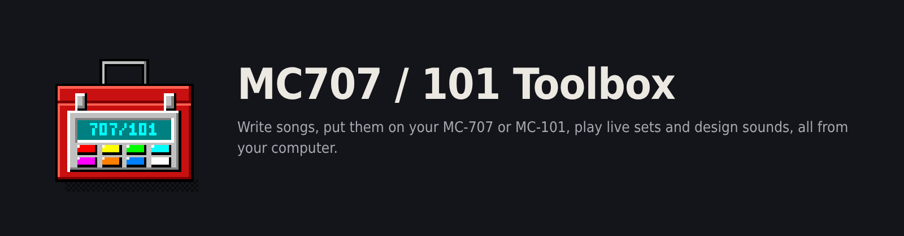
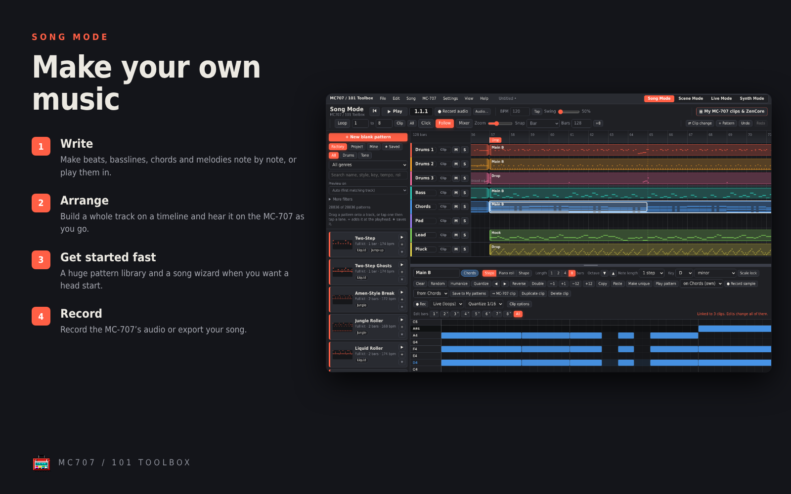
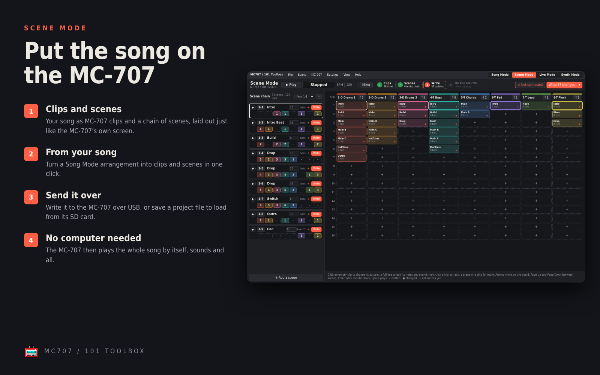
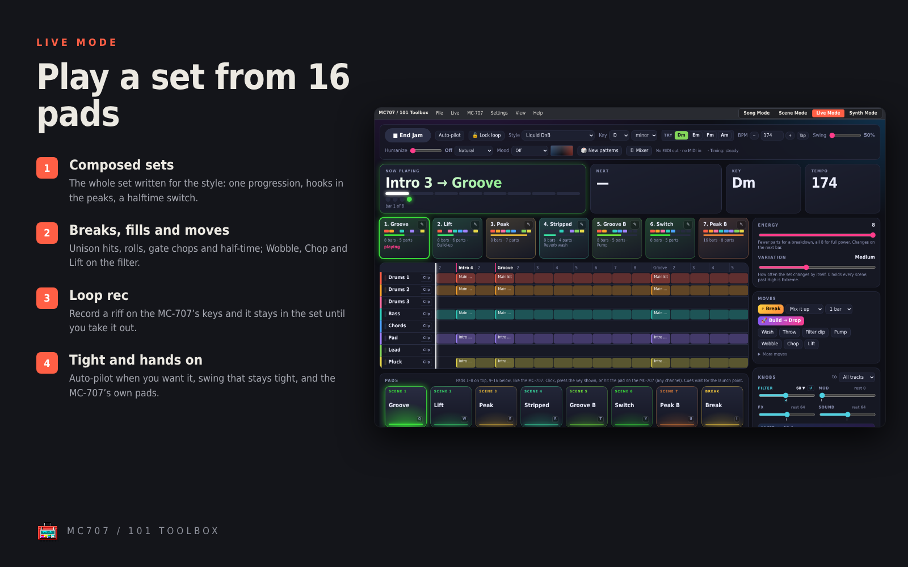
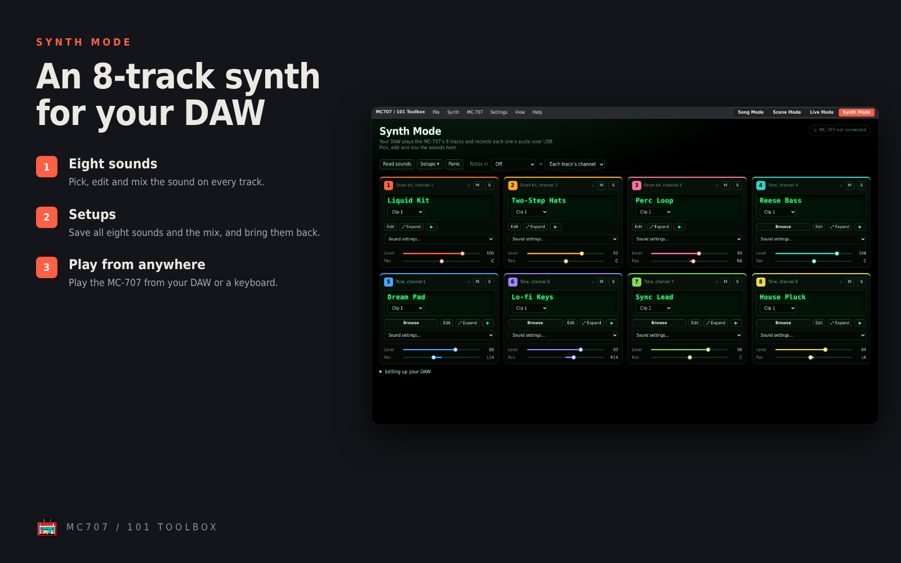
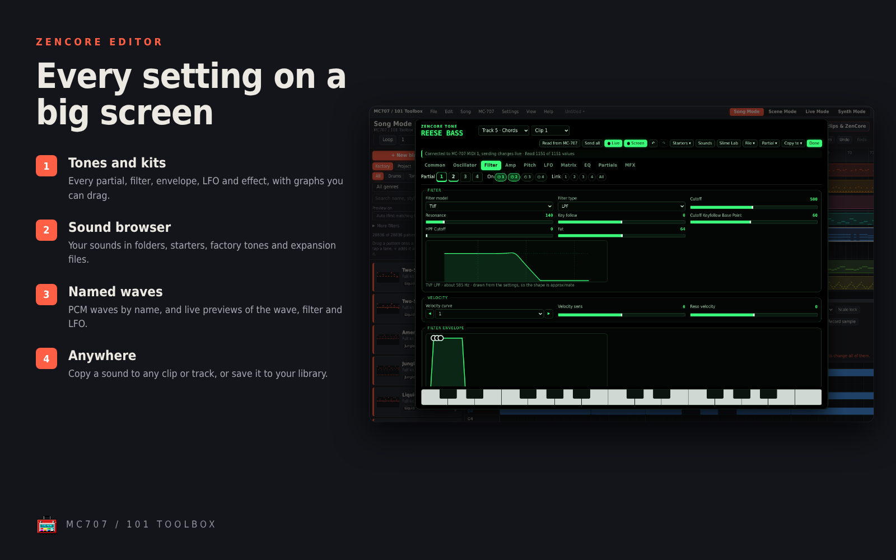
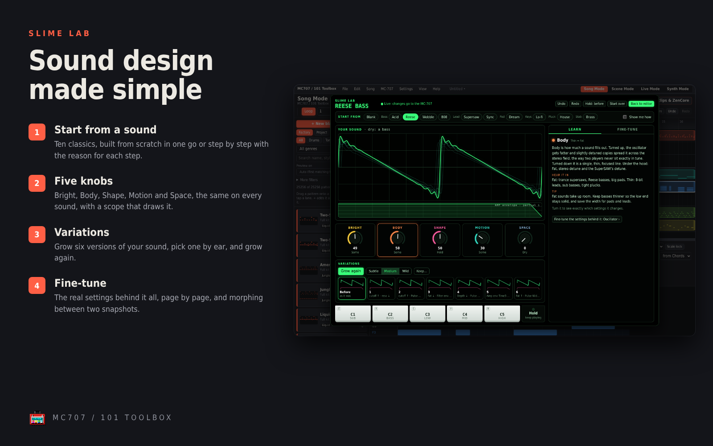

# MC707 / 101 Toolbox



Write songs, put them on your **Roland MC-707 or MC-101**, play live sets and design sounds, all from your computer. One USB cable carries every track, and the app can record the audio that comes back.

> **Version 1.9.0.** Free to use and share, not for sale (see [Licence](#licence)). An unofficial fan project, not made by or affiliated with Roland. It was called MC-707 Toolbox until 1.7; [what's new](CHANGELOG.md) in every release.

**Try it:** open the [web version](https://mendo-707.github.io/mc707-toolbox/) in Chrome or Edge, or download the app for Windows, Mac or Linux from [Releases](../../releases).

## What it does

### Song Mode

Make your own music and play it on the MC-707 note for note. Write drums, bass, chords and melodies in a step grid or piano roll (or play them in on your keys), and arrange them on a timeline into a whole song. Over 28,000 patterns in 42 styles and a song wizard are there when you want a head start. Record every track's audio over USB, or export MIDI. [More](#song-mode-1)



### Scene Mode

Turn your song into MC-707 clips and a chain of scenes, on a board laid out just like the MC-707's own screen. Write it over USB or save a project file for the SD card, and the MC-707 plays the whole song by itself, sounds and all, with no computer. [More](#scene-mode-1)



### Live Mode

Play a live set from 16 pads, laid out like the MC-707's. Pick a style and the app writes a set of scenes that fit together; change scenes, swap parts and drop breaks, fills and builds, all on the beat. Record your own riffs into the set with Loop rec, or let auto-pilot run it. [More](#live-mode-1)



### Synth Mode

The MC-707 as an 8-track synth for your DAW: pick, edit and mix the sound on each track, open any track's editor beside the others, and save all eight sounds as a setup. [More](#synth-mode-1)



### ZenCore editor

Every setting of the MC-707's tones and drum kits on a big screen, with filters, envelopes and LFOs you can drag, and a sound library for your own sounds, starters and factory tones. [More](#zencore-editor-1)



### Slime Lab

Sound design made simple: start from a classic sound, shape it with five knobs that work the same on every sound, grow variations and pick one by ear, then fine-tune it and save it to your sounds. [More](#slime-lab-1)



## Getting started

### Windows app (recommended)

Download from [Releases](../../releases):

- **`MC-707-Toolbox-Setup.exe`**: the installer. It adds the app to the Start menu and desktop and opens faster. Install a newer version over the top; your songs, settings and My patterns stay. Uninstall it from Windows **Settings › Apps**.
- **`MC-707-Toolbox.exe`**: the portable app. One file, no install; it runs from anywhere, even a USB stick.

Both keep their work in the same place, so you can switch between them. The first time you open either one, Windows may say _"Windows protected your PC"_ because the app isn't code-signed. Click **More info**, then **Run anyway**.

**Build it yourself:** install **Node.js LTS** from <https://nodejs.org>, double-click **`build-exe.bat`** and wait 2–5 minutes. Both files appear in the **`dist`** folder. If the build fails, the details are in `build-log.txt`.

### Mac app

Download from [Releases](../../releases): **`MC-707-Toolbox-mac-arm64.dmg`** for Apple Silicon Macs (M1 and later) or **`MC-707-Toolbox-mac-x64.dmg`** for Intel Macs (Apple menu › About This Mac shows which you have). Open it and drag **MC707-101 Toolbox** into **Applications**.

The app isn't signed with a paid Apple developer certificate, so the first time you open it macOS says it can't check it. Click **Done**, then open **System Settings › Privacy & Security**, scroll down to _"MC707-101 Toolbox was blocked"_ and click **Open Anyway**. After that it opens normally. Allow the microphone when it asks if you want to record audio.

**Build it yourself** (on a Mac): install Node.js LTS, then `npm install` and `npm run dist:mac` in this folder.

### Linux app

Download from [Releases](../../releases):

- **`MC-707-Toolbox-linux-amd64.deb`** for Ubuntu, Debian, Mint and the like: `sudo apt install ./MC-707-Toolbox-linux-amd64.deb`, then open it from your apps.
- **`MC-707-Toolbox-linux-x86_64.AppImage`** for any other Linux: make it executable (`chmod +x`) and run it. It needs FUSE 2 (`sudo apt install libfuse2t64` on Ubuntu 24.04, `libfuse2` on older ones). If Ubuntu 24.04 or later stops it with a sandbox error, start it with `--no-sandbox` or use the .deb.

**Build it yourself:** install Node.js LTS, then `npm install` and `npm run dist:linux`.

The Mac and Linux apps are new in 1.4 and haven't been tried on a real MC-707 yet: if yours doesn't show up in **MC-707 › Set up your MC-707**, install Roland's MC-707 driver for your system if there is one, and please tell us in an [issue](../../issues).

### In a browser

Open the [web version](https://mendo-707.github.io/mc707-toolbox/), or download `index.html` and open it, in **Chrome or Edge**. Everything works except real folders and Save As dialogs, which need the desktop app. Firefox and Safari don't support Web MIDI.

### Template builder

**MC-707 › Template builder** makes an MC-707 project to start from, with a sound in every clip:

- **Track layout:** 3 drum + 5 tone, 2 + 6, 4 + 4, 1 + 7, all tone, all drum, the same as your Track setup, or set each track yourself (main kit, hats, percussion, bass, keys, pads, leads, plucks, effects).
- **Sounds:** pick a genre and every clip gets a factory kit or tone that suits its track, none twice. Change any clip, get new picks, use one sound on a track, or use your own sounds and the starters too. (The factory sounds come from the MC-707's update file: Sound browser › Grab from.)
- **Clips:** how many on each track and how long, and the tempo.
- **Save to the MC-707:** put the MC-707 in storage mode (hold **SHIFT**, press **KNOB ASSIGN**, pick **STORAGE MODE**, press **ENTER**, connect USB), save the file onto its SD card in the folder with your other projects, eject, then **PROJECT › LOAD** it. The app's Track setup can follow the same layout.

Empty templates (no sounds), one per layout, are here too: [MC707-Project-Templates.zip](templates/MC707-Project-Templates.zip).

### Save as an MC-707 project file

**File › Save as MC-707 project (.mpj)** (also in the MC-707 menu, and Scene Mode's Write menu) turns the song into a project file to copy onto the MC-707's SD card and load there, with no computer: Scene Mode's clips and scenes (or, if it has none, the ones it would make from the song, leaving the song as it is), each clip's notes as Scene Mode writes them over USB, the scene chain (stopping on the last scene), the tempo and a name. It starts from Roland's empty project for your Track setup, names each clip after its pattern, and sets every track to play its clips' sounds (Sound Source CLIP), so each clip carries the tone or factory drum kit you gave it in Scene Mode, written exactly as the MC-707 stores it. Factory kits come in with the factory tones from the MC-707 update file (Sound browser › Grab from). Clips without a sound keep the template's (TR-808 and TR-909 kits, a piano); kits grabbed from the MC-707 or made in the editor, and Pump and other motion, are not in the file yet. Copy the file to the SD card in storage mode (see above) and load it with **PROJECT › LOAD**: it opens on the first scene with the scene chain on, so **PLAY** plays the song. Save the project on the MC-707 to keep any changes you make there.

### Open an MC-707 project file

**MC-707 › Open an MC-707 project file (.mpj)** reads a project copied off the MC-707's SD card in storage mode (see above; the file is only read, never changed). It shows the project's name and tempo, each track's kind (drum, tone, looper) and sound name, and which clips hold notes. **Bring the clips into Scene Mode** puts every clip's notes, length and step size in the same track and clip on Scene Mode's board, as patterns you can edit and write back (the tracks take their sounds' names, the song the tempo; tracks of the other kind can be switched to match). **Add them to My patterns** keeps them in your library. Samples in the project play with ▶ and save as WAV files, one at a time or all in a zip, and so do the looper tracks' recordings. Its scenes come in too, all of them up to the last that plays something, each with its chain length (a scene set to OFF lasts as long as its longest clip). Not read yet: the sounds themselves (only their names) and motion.

### Connect the MC-707

1. Plug the MC-707 into the computer by USB.
2. The app connects by itself: as it opens, or as soon as the MC-707 (or MC-101) is plugged in, it connects notes, the pads and keys, the clock (the first time) and the ZenCore editor, and says so. In a browser this happens once MIDI is allowed for the page; otherwise, or with **Settings › Connect to the MC-707 by itself** turned off, open **MC-707 › Set up your MC-707** and press **Auto-connect MC-707**.
3. Press **Play tracks 1 → 8**. Each MC-707 track should sound in turn. If one is wrong, change its channel there.
4. On the MC-707 (SHIFT + KNOB ASSIGN › SET › MIDI tab), set **MIDI Rx Auto Channel** to **OFF** and **Track Channel 1-8** to CH1–CH8. Quick setup walks through every setting that matters.
5. Set every track's **Sound Source** to **CLIP** (hold SHIFT and press the track's TRACK SEL, GENERAL tab), so each clip keeps its own sound, and give each clip a sound. Scene Mode, the clip switching and MC-707 project files all count on it.
6. Optional: tick **Make the MC-707 follow this app** to send MIDI clock and start/stop. On the MC-707, set sync to AUTO or USB.

---

## Opening the app

The app opens in Song Mode with a **start screen**:

- **Load last session**: pick up where you left off.
- **Blank song**: an empty arrangement.
- **Empty template**: 64 bars with intro, build, drop, break, drop 2 and outro marked.
- **Song wizard**: compose a whole song in a style you pick, or build an arrangement step by step.
- **Live Mode**: choose a genre and jam.

At its foot, **📖 Tutorials** (also in **Help**) walk through what to set on the MC-707 and in the app: **Basic setup** (connecting and the tracks) first, then a short tutorial for each mode (Song, Scene, Live, Synth, the ZenCore editor and the Slime Lab), page by page. Tick each step as you go, press **Show me** to see the control a step talks about, and **Help › Tutorial: this mode** opens the one for the mode you are in. Untick _Show this when the app opens_ to skip it; **File › Start screen** brings it back. Live Mode asks for a genre when it opens; keep the one you had, or pick another any time from **Live › Pick a genre**.

## Song Mode

| Feature                      | What it does                                                                                                                                                                                                                                                                                                                                                                                                                                                                                                                                                                                                                                                                                                                                                                                                                           |
| ---------------------------- | -------------------------------------------------------------------------------------------------------------------------------------------------------------------------------------------------------------------------------------------------------------------------------------------------------------------------------------------------------------------------------------------------------------------------------------------------------------------------------------------------------------------------------------------------------------------------------------------------------------------------------------------------------------------------------------------------------------------------------------------------------------------------------------------------------------------------------------- |
| **Song wizard**              | Pick one of 42 styles (drum and bass, hip hop, house, techno, garage, big beat, funk, ambient and more) and hear each at its own tempo. **Compose it now** (with a **Mood**: as the style is, Dark, Hard, Banger or Chill) writes the whole song in one go: every part from one chord progression, drums from the style's groove, a bass locked to the kick, a hook that develops, builds that stop dead before the drop and something new in every drop or chorus, with Scene Mode set up the same way and (with Choose sounds) a factory tone or kit on every clip. Or go step by step: you get a full arrangement with tempo, key and sections. Bass, chords, pads and arps share one progression. There are fills, a build before each big section and an impact on the drop, plus MC-707 factory tones suggested for every track. |
| **Pattern library**          | Over 28,000 drum and tone patterns, filtered by genre, role, key and length, with favourites you can star. It includes fills, builds and drop impacts, voice-led chords, basslines that follow each chord, real hi-hat rolls and sliding 808s for trap and drill, 303-style acid lines, and the packs below.                                                                                                                                                                                                                                                                                                                                                                                                                                                                                                                           |
| **Harmony pack**             | 20 unusual progressions, among them a lament bass falling under slash chords, chromatic mediants, the Neapolitan, a Picardy major ending, tritone substitutes, the royal road, the Mario cadence, a backdoor and a gospel turn. Their chords don't all change on the bar: there are 3+3+2 splits, long-short holds, turnarounds that speed up, and changes pushed an eighth early. They come in 8- and 16-bar loops, each with three chord rhythms, two basslines, a pad, an arp and a lead, in every genre. The song wizard and Live Mode only pick the plainer timings (two bars or a bar per chord, the 16-bar phrases); the busier ones are in the library to choose by hand. Search the library for a name such as _Neapolitan_ or _Royal Road_.                                                                                  |
| **Melodic pack**             | 11,000 new pads, arps, leads and chord rhythms, written over every chord progression in the library so each one has its own parts instead of the same few rhythms. Pads pulse, swell, gate, hold a moving top line or suspend into the chord; arps run up, down, converge, wander, leap or pedal in 16ths, 8ths, triplets or dotted 8ths over one to three octaves; leads follow twelve phrase rhythms and six melodic shapes, land on a note of the chord on the beat and end on the key's root; chord parts comp in fifteen rhythms (house stabs, skank, Charleston, tresillo, two-step, gospel pushes, rolled and broken chords). Each keeps its progression's name, key and length, so Live Mode and the song wizard play them with the matching chords and bass. Search for _Arp_, _Swell_, _Tresillo_ or _Gospel_.               |
| **Big Beat**                 | A new style and genre: late-90s breakbeat rock-dance at 110–140 BPM. 48 chopped funk breaks and stomping beats (with crash and tambourine versions), tambourines, shakers, cowbell and congas, distorted riffs, octave, fuzz and acid basslines, stabs, horn hits, power chugs, organ, sirens, hoover stabs and wah guitar on minor-pentatonic and mixolydian progressions, plus its own intros, fills, snare-roll builds, impacts and flash breaks. In Live Mode and the song wizard, under Dance and club.                                                                                                                                                                                                                                                                                                                           |
| **Variety and groove packs** | Borrowed chords, line clichés, modal vamps (Dorian, Mixolydian, Lydian, Phrygian, harmonic minor, blues), two chords to a bar, pedal points and sus chords that resolve, with rhythms from clave, tresillo, gates and pushes.                                                                                                                                                                                                                                                                                                                                                                                                                                                                                                                                                                                                          |
| **Pattern editor**           | A step grid, piano roll and fade or automation shapes. **Edit bars** changes one block, and **Repeat to end** copies it through. Click any library pattern to open it, play it and change it, then **Place at playhead**. Editing a factory pattern changes your own copy, never the library. **Save to My patterns** keeps it in your own library (the **Mine** tab).                                                                                                                                                                                                                                                                                                                                                                                                                                                                 |
| **New patterns and MIDI**    | **+ New blank pattern** at the top of the library (or **+ Pattern**) makes a blank drum or tone pattern, or loads MIDI files from any folder or USB drive (or drop `.mid` files on the arranger). Channel 10 parts become drums.                                                                                                                                                                                                                                                                                                                                                                                                                                                                                                                                                                                                       |
| **Fine clip edges**          | Clips can start and end anywhere, down to 1/256 bar. **Snap** offers bar, ½ bar, beat, step, 1/32, 1/64 or Free; hold **Shift** while dragging to ignore it. **Clip options** take exact positions in steps, fractions included (2.5 is half a step later), plus where in the pattern the clip starts and a loop length for polyrhythms.                                                                                                                                                                                                                                                                                                                                                                                                                                                                                               |
| **Clips that work together** | Linked clips share a pattern: edit once and every copy changes, or **Make unique**. Double-click one repeat of a long clip to edit just that block. **Glue** (G) joins touching clips back into one.                                                                                                                                                                                                                                                                                                                                                                                                                                                                                                                                                                                                                                   |
| **Structure and transpose**  | Copy, paste, repeat, insert and delete whole sections. Transpose the song or just part of it.                                                                                                                                                                                                                                                                                                                                                                                                                                                                                                                                                                                                                                                                                                                                          |
| **MC-707 clip changes**      | Press **K** or **⇄ Clip change** to switch a track to another MC-707 clip at the playhead (**Shift+K** flips straight back). **Switch back and forth** alternates two clips every 1, 2, 4 or 8 bars. Section markers can set clips for every track and switch MC-707 scenes. Playing from the middle of the song puts every track on the right clip first.                                                                                                                                                                                                                                                                                                                                                                                                                                                                             |
| **Record audio**             | **2 channels:** one stereo file from the MC-707's mix or any audio interface, with optional stems played track by track. **8 channels:** the mix plus every MC-707 track as its own file, recorded together over USB (Windows shows the MC-707 as one 20-channel input or as separate inputs; **Match by name** sets them up). Saves WAV or MP3.                                                                                                                                                                                                                                                                                                                                                                                                                                                                                       |
| **Sample grabber**           | The **◉** on the playhead records 1–16 bars of the mix, one track or Ext In to a WAV, from the next bar line, ready to load into the MC-707 as a sample. **● Record sample** in the editor grabs one pattern on its own.                                                                                                                                                                                                                                                                                                                                                                                                                                                                                                                                                                                                               |
| **Export MIDI**              | A `.zip` with the whole song and one `.mid` per track.                                                                                                                                                                                                                                                                                                                                                                                                                                                                                                                                                                                                                                                                                                                                                                                 |
| **Mixer**                    | **🎚 Mixer** (or Song › Mixer) opens the song's mix in a window you can drag onto another screen: per track level, pan, reverb, chorus and note velocity, mute and solo, with a light and meter for the notes going out. It's saved with the song, has undo, and is sent to the MC-707 as you move it and when the song starts. Right-click a strip to solo only it or reset it.                                                                                                                                                                                                                                                                                                                                                                                                                                                       |
| **Menus**                    | Each mode shows only its own menus. **Help** has the guide, MC-707 setup, troubleshooting, update checks, problem reports and **About**.                                                                                                                                                                                                                                                                                                                                                                                                                                                                                                                                                                                                                                                                                               |
| **Right-click**              | Quick options on the Play button, clips, tracks, lanes, markers and library patterns; in Live Mode on scene cards, pads, tracks, keys and the mood pad; on Synth Mode strips (copy a sound to another track, save it to the Sound library, reset the mix); on Sound browser rows; and on every ZenCore control (back to the start value, copy and paste a value, the same value on all four partials). Hover over a control for a short note on what it does.                                                                                                                                                                                                                                                                                                                                                                          |

## Live Mode

| Feature                           | What it does                                                                                                                                                                                                                                                                                                                                                                                                                                                                                                                                                                                                                                                                                                                                                                                                                                                                                                                                                                                                                                                                                                                                                                                                                                                                                                                                                                                                                                                                                                                                                                                                        |
| --------------------------------- | ------------------------------------------------------------------------------------------------------------------------------------------------------------------------------------------------------------------------------------------------------------------------------------------------------------------------------------------------------------------------------------------------------------------------------------------------------------------------------------------------------------------------------------------------------------------------------------------------------------------------------------------------------------------------------------------------------------------------------------------------------------------------------------------------------------------------------------------------------------------------------------------------------------------------------------------------------------------------------------------------------------------------------------------------------------------------------------------------------------------------------------------------------------------------------------------------------------------------------------------------------------------------------------------------------------------------------------------------------------------------------------------------------------------------------------------------------------------------------------------------------------------------------------------------------------------------------------------------------------------- |
| **Start Jam and End Jam**         | **▶ Start Jam** opens with a few 2-bar intro loops built from the first scene, rising into the drop (Shift-click skips them). **■ End Jam** ends within 1–2 bars: a last hit, a thinned-out bar and a hit, or a short fade. Press it again to stop at once.                                                                                                                                                                                                                                                                                                                                                                                                                                                                                                                                                                                                                                                                                                                                                                                                                                                                                                                                                                                                                                                                                                                                                                                                                                                                                                                                                         |
| **Patterns**                      | **Composed** (the default) has the composer write the whole set for the style: one chord progression for every part, drums from the style's own groove, a bass locked to the kick, pads that follow every chord, hooks in the Peaks, a new beat and bass in the B scenes and a halftime Switch, with swaps moving between the composed parts. Or pick a flavour **from the pattern library** (Lively, Mixed or Classic) to play parts from the 28,000-pattern library instead.                                                                                                                                                                                                                                                                                                                                                                                                                                                                                                                                                                                                                                                                                                                                                                                                                                                                                                                                                                                                                                                                                                                                      |
| **Scenes**                        | Seven loops built for playing live. A Composed set has Groove, Lift, Peak, Stripped, Groove B, Switch (halftime) and Peak B; a set from the pattern library has Groove, Lift, Peak, Stripped, Groove B, Tool and Peak B. Each has its own mix of parts and length, and parts come and go so the loop breathes. A big jump in energy lands as a drop. Press ✎ to edit any scene: its name, length, energy, the pattern and MC-707 clip on each track (stay, pick one or **random**), and which bars each part plays.                                                                                                                                                                                                                                                                                                                                                                                                                                                                                                                                                                                                                                                                                                                                                                                                                                                                                                                                                                                                                                                                                                 |
| **16 pads**                       | Laid out like the MC-707. Pads 1–7 hold the scenes and pad 8 is **Break**. The bottom row holds the Drums, Bass, Chords and Lead swaps, Fill, Stutter, Build → Drop and Next scene. Select a drum track on the MC-707 and its pads work straight away. You can also use the mouse or computer keys (`Q`–`I` top row, `A`–`K` bottom row).                                                                                                                                                                                                                                                                                                                                                                                                                                                                                                                                                                                                                                                                                                                                                                                                                                                                                                                                                                                                                                                                                                                                                                                                                                                                           |
| **Break and Build → Drop**        | **Break** gives a quick flash (unison hits, stutter, snare roll, drop-out, a gate chop of the whole loop, or half-time), then it's straight back in on the downbeat with a crash. **Build → Drop** brings a snare build that doubles to a roll, a filter riser, a cut and a beat of silence, then the drop with an impact, over 2, 4 or 8 bars.                                                                                                                                                                                                                                                                                                                                                                                                                                                                                                                                                                                                                                                                                                                                                                                                                                                                                                                                                                                                                                                                                                                                                                                                                                                                     |
| **Humanize**                      | Next to Swing: makes the band sound played, not just randomly wobbly. Each instrument sits in its own spot against the beat (snare a touch behind, hats on top, keys behind, a lead that floats) and drifts a little over time, the bass locks to wherever the kick landed, and the whole band breathes together. Downbeats and the backbeat lean in, hat strokes alternate hands, and the players lean into every fourth bar. Chords are strummed up and down instead of struck as a block, and at higher amounts the snare sometimes flams. Pick a feel: **Natural**, **Laid back**, **Pushed** or **Drunk** (loose and lazy, after J Dilla). Off is machine-tight, exactly as before.                                                                                                                                                                                                                                                                                                                                                                                                                                                                                                                                                                                                                                                                                                                                                                                                                                                                                                                            |
| **Mood**                          | Next to Humanize: pick **Angry**, **Dark**, **Driving**, **Euphoric**, **Uplifting**, **Chill**, **Dreamy** or **Melancholy**, or drag the little pad (calm to intense across, dark to bright up). The set is rebuilt from patterns that feel that way inside the style: intense moods pick harder, busier, shorter parts, play them harder and nearer the top of the style's tempo range, and come in and drop hard; calm moods pick softer, sparser, longer parts, play them softer and slower, lay back and come in smoothly. Dark moods pick minor, clashing, lower parts; bright moods major, open, higher ones. While playing, the new set comes in over one bar from the next bar line: intense moods roll the snare, open the filter and slam in on a crash after an eighth of silence; calm moods let the beat fall away, close the filter and wash into it. Off (or a double-click on the pad) picks from the whole style again. The song wizard has the same Mood choice.                                                                                                                                                                                                                                                                                                                                                                                                                                                                                                                                                                                                                                |
| **Built for the stage**           | The clock runs on its own thread, so it keeps time with the window in the background. If the computer freezes for a moment, the set carries on from where it was instead of firing the missed notes all at once; if something goes wrong inside the app, it's logged and the music carries on. If the USB cable comes out, a red banner says so while the set keeps time; plug it back in and every note is released, then the scene's clips and levels are sent again, in time. Timing is tight with swing and Humanize on: a note never cuts the next one of the same key short, notes go out on a steady clock (no wobble from the sound card's buffer), and echoes, fill runs and rolls swing with the groove. Every release is played through hours of simulated sets with thousands of random pad presses, checking that every note is released and every effect returns to rest.                                                                                                                                                                                                                                                                                                                                                                                                                                                                                                                                                                                                                                                                                                                             |
| **Fades**                         | When a scene changes, pads fade in and out on the MC-707's own volume (expression, CC 11), so held notes fade too, and chords fade briefly. Bass, leads, plucks and arps never fade: they come in on the downbeat and stop on the change, letting their last notes ring out. **Entry** in Settings and mapping sets how long the pads take: Smooth (1 bar), Slow (2 bars), Long (4 bars), Very long (8 bars) or Hard cut. **Live › Stop at end of phrase** lets the melody finish with the phrase, then fades the drums, chords and pads over 2 bars. Fills always end exactly on the downbeat they lead into.                                                                                                                                                                                                                                                                                                                                                                                                                                                                                                                                                                                                                                                                                                                                                                                                                                                                                                                                                                                                      |
| **New patterns**                  | **🎲 New patterns** drops to the drums from the next bar, blends the new set's drums in, and brings in its first scene after 2–6 bars, so the music never stops.                                                                                                                                                                                                                                                                                                                                                                                                                                                                                                                                                                                                                                                                                                                                                                                                                                                                                                                                                                                                                                                                                                                                                                                                                                                                                                                                                                                                                                                    |
| **Moves**                         | **Wash**, **Throw**, **Filter dip**, **Pump** and **Autopan** on the MC-707's own controls, plus **Wobble** (the bass's filter in eighths for 2 bars), **Chop** (the chords and pads gated in 16ths for 2 bars) and **Lift** (filter and resonance rise over a bar and snap back), and a move per scene. During builds, resonance climbs, reverb washes up and the tone parts pump; it all snaps back on the drop (untick **Epic builds** to turn that off).                                                                                                                                                                                                                                                                                                                                                                                                                                                                                                                                                                                                                                                                                                                                                                                                                                                                                                                                                                                                                                                                                                                                                        |
| **Loop rec**                      | Record 1, 2, 4 or 8 bars on a keyboard or the MC-707's keys while the set plays, with a count-in and Quantize (1/16, 1/8, triplets or Off, changeable later). ▶ Play puts the take in the set from the next bar, and it stays on its track through scene changes, auto-pilot, swaps, New patterns, the energy and a restart until **■ Back**. Then grow it: **＋ Overdub** adds a layer over it as it plays (**↶ Undo layer** takes it off), **Vary** plays it a little differently some times round, **½×** and **2×** change its speed, and **⤓ My patterns** keeps it for Song Mode.                                                                                                                                                                                                                                                                                                                                                                                                                                                                                                                                                                                                                                                                                                                                                                                                                                                                                                                                                                                                                             |
| **Staying in tune**               | Every tone part in a set follows one chord progression, and swaps and guest melodies only pick parts that fit it. Leads and plucks that clash with their chords, or run in triplets across a straight beat, are left out of the automatic picks, and **Chord lock** (under More moves, on by default) moves a lead or pluck note that lands on a beat against the chord to the nearest chord note. Key and **minor/major** change any time; **Try** shows keys that suit the style.                                                                                                                                                                                                                                                                                                                                                                                                                                                                                                                                                                                                                                                                                                                                                                                                                                                                                                                                                                                                                                                                                                                                 |
| **Variation, Energy, Auto-pilot** | **Variation** sets how often the set changes by itself, up to **Extreme**. **Energy** goes from a sparse breakdown to all 8 parts. **Auto-pilot** runs the set like a DJ would, with a Chaos amount: the scenes follow an arc (groove, lift, peak, a second peak, a breakdown and back) rather than going round the list, a lift builds into its peak with a snare build and the filter riser, a filter dip or reverb throw lands now and then in a peak, about every twelve scene changes a breakdown brings in fresh patterns (never on a set you edited), and with Chaos at half or more the key sometimes lifts a tone out of a breakdown, going back home with the fresh patterns. **🔒 Lock loop** holds exactly what's playing; **＋ Save as scene** keeps it.                                                                                                                                                                                                                                                                                                                                                                                                                                                                                                                                                                                                                                                                                                                                                                                                                                               |
| **Acid**                          | 303-style lines with accents, slides and octave jumps for techno, acid techno, house, trance, electro, breakbeat and drum and bass. Mark a clip as **Acid** and Live Mode plays them on it.                                                                                                                                                                                                                                                                                                                                                                                                                                                                                                                                                                                                                                                                                                                                                                                                                                                                                                                                                                                                                                                                                                                                                                                                                                                                                                                                                                                                                         |
| **Knobs and XY pad**              | The MC-707's FILTER, MOD, FX and SOUND knobs (CC 80–83) and the XY pad, each showing where it rests.                                                                                                                                                                                                                                                                                                                                                                                                                                                                                                                                                                                                                                                                                                                                                                                                                                                                                                                                                                                                                                                                                                                                                                                                                                                                                                                                                                                                                                                                                                                |
| **Raven mode**                    | Inspired by the Quasimidi Raven: one octave changes the key of every melodic part, another mutes and unmutes tracks, and four keys give Unmute all, Fill, Build → Drop and Break. There are eight presets (Classic Raven, Raven Mute B, DJ cuts, Key jockey, Drop builder, Lead player, Bass player and Chord jam), and it works from the MC-707's keys or a controller keyboard. **Takeover:** play a track yourself (the solo keys, or the MC-707's keys on that track) and the app stops playing its pattern there and stops sending it effects, fades and clip changes; it takes the track back 4 bars after your last note. **Loop rec** records your own riff into the set. Choose the track (or the track you play), the length (1, 2, 4 or 8 bars) and the Quantize, then press **● Rec**: it starts the jam if it is stopped, counts the beats down to a bar line, and shows **REC** in the Now playing box. While you record, that track's own part goes quiet and your notes appear as you play them (playing another track says so); **■ Stop** ends early, **Cancel** throws it away. The take then waits in a card with the set unchanged: **▶ Play** puts it on its track from the next bar, exactly as you played it, **↺ Again** records another, **✕ Discard** throws it away. In the takes list, **■ Back** brings the set's own part back, **★** makes the scene keep a take, and each take's own Quantize changes it from the notes as you played them. **Settings and mapping › Loop rec** has a bar's count-in, keeping the track playing while you record, and playing takes straight away. |
| **Controller keyboard**           | Plug in a USB keyboard as well (FLkey, Launchkey, KeyLab, MPK, Oxygen Pro, Komplete Kontrol, Roland A-49 and others). Its keys mute, change key and play a live solo on any track. Knobs, faders and pads control the set, and **Learn all controls in order** matches your model.                                                                                                                                                                                                                                                                                                                                                                                                                                                                                                                                                                                                                                                                                                                                                                                                                                                                                                                                                                                                                                                                                                                                                                                                                                                                                                                                  |
| **Capture to Song**               | Turns what you just played into a Song Mode arrangement, with a marker for each scene.                                                                                                                                                                                                                                                                                                                                                                                                                                                                                                                                                                                                                                                                                                                                                                                                                                                                                                                                                                                                                                                                                                                                                                                                                                                                                                                                                                                                                                                                                                                              |
| **Stage ready**                   | Seven colour themes, a reactive visualizer, **F11** fullscreen, and the screen stays awake while playing.                                                                                                                                                                                                                                                                                                                                                                                                                                                                                                                                                                                                                                                                                                                                                                                                                                                                                                                                                                                                                                                                                                                                                                                                                                                                                                                                                                                                                                                                                                           |
| **Mixer**                         | **🎚 Mixer** (or Live › Mixer) opens Live's own mix, kept apart from the song's, in a window you can drag onto another screen, in your Live theme's colours. Level, pan, reverb and delay become the rest values moves come back to and are sent at Start; mutes and solos wait for the next beat while the jam plays (they blink until they land). Each strip shows a track the energy level took out or one you're playing yourself.                                                                                                                                                                                                                                                                                                                                                                                                                                                                                                                                                                                                                                                                                                                                                                                                                                                                                                                                                                                                                                                                                                                                                                              |

## Scene Mode

Arrange a song the way the MC-707 keeps one, then write it there so the MC-707 plays it by itself, with no computer. In Song Mode's look, in three parts, with the four steps of the job along the top: **1 Clips › 2 Scenes › 3 Write › 4 On the MC-707**, each showing how far it has got. New and experimental: use a project you can lose the first time, and save the project on the MC-707 to keep what is written.

|                                 |                                                                                                                                                                                                                                                                                                                                                                                                                                                                                                                                                                                                                                                                                                                                                                                                                                                                                                                                                                                                                                                                                                                                                                                                                                                                                                                       |
| ------------------------------- | --------------------------------------------------------------------------------------------------------------------------------------------------------------------------------------------------------------------------------------------------------------------------------------------------------------------------------------------------------------------------------------------------------------------------------------------------------------------------------------------------------------------------------------------------------------------------------------------------------------------------------------------------------------------------------------------------------------------------------------------------------------------------------------------------------------------------------------------------------------------------------------------------------------------------------------------------------------------------------------------------------------------------------------------------------------------------------------------------------------------------------------------------------------------------------------------------------------------------------------------------------------------------------------------------------------------- |
| **Clips board**                 | Laid out like the MC-707's CLIP screen: a column for each track (1-D … 8-T) with its 16 clips down it, so a scene's clips read across as they do on the MC-707. A clip is a pattern (with a transpose) and the tone it should have. Click an empty clip to choose its pattern (the library by genre and part, with ▶ to hear it, My patterns or the song's own), a full one to edit it. The clips the selected scene plays are outlined; clips no scene plays are faded. Right-click a clip to edit it, change its pattern or tone, transpose it, play it, put it in or take it out of the selected scene, write it, copy, paste, move or swap it with another clip (the scenes follow), clear it, or read the MC-707 clip's notes or open its sound there. Right-click a track to write or check its clips.                                                                                                                                                                                                                                                                                                                                                                                                                                                                                                          |
| **Scene chain**                 | Down the left, the scenes in the order the MC-707's scene chain plays them, from the scene you pick (1-1, 1-2 … as Call Scene TYPE2 numbers them). Each has a name, how many bars it plays before the next (the last keeps playing, ↻), and a chip per track for the clip it plays: click a chip to choose another clip, a new one or nothing. ▶ plays from a scene; right-click to loop it, write it, add one before or after, copy, move or remove it.                                                                                                                                                                                                                                                                                                                                                                                                                                                                                                                                                                                                                                                                                                                                                                                                                                                              |
| **Clip editor**                 | Under the board, for the selected clip: **Notes** is Song Mode's own pattern editor (steps, piano roll, velocity, length, scale lock and its tools), **Sound** the full ZenCore editor with its Sound browser (your sounds, the factory tones from your update file, the starters), working on that MC-707 clip as you go and kept as the clip's tone. ◀ ▶ step through the track's clips; it says which scenes play the clip, and **Make it this clip's own** copies a pattern other clips share. **⤢ Expand** gives the editor the board's room.                                                                                                                                                                                                                                                                                                                                                                                                                                                                                                                                                                                                                                                                                                                                                                    |
| **Written, changed, new**       | Every clip and scene shows **✓** written to the MC-707, **●** changed since, **!** written but read back differently (**Write ▾ › Show the last write report** says how), or **+** not written yet, so you and the MC-707 stay on the same page. The marks are saved with the song; **Forget what was written** clears them after you load another project on the MC-707.                                                                                                                                                                                                                                                                                                                                                                                                                                                                                                                                                                                                                                                                                                                                                                                                                                                                                                                                             |
| **Write**                       | **Write n changes** sends only what is new or changed. Or write one clip (its button in the editor, or right-click), a track's clips (⤒ by its name), or one scene (its Write button; the clips it plays that are not written go first). **Write ▾** has write everything, the clips only or the scenes only, **Auto-write** (changes go over a moment after you make them, when the MC-707 is connected and nothing is playing), and the settings: write over clips that hold notes, send the tones, name clips after their patterns, set the MC-707's tempo. **Check the new clips** reads them (read-only) and rings any that already hold notes there.                                                                                                                                                                                                                                                                                                                                                                                                                                                                                                                                                                                                                                                            |
| **Pump (sidechain)**            | Right-click a clip › **Pump (sidechain)…**, or **∿ Pump** in the clip editor: the part ducks on every kick and comes back, written into the clip's motion so the MC-707 pumps it by itself. **Volume** moves the SOUND (C4) knob (on the MC-707, press KNOB ASSIGN on that track and set SOUND (C4) to Level, once); **Filter** moves the FILTER knob (cutoff). Pick the depth (light, medium, heavy) and where it rests, and set finely, in eighths of a 16th with the time in ms, when it **starts** against the kick (early, on it, or late to let the kick through), how long it **holds down**, and how long it takes to **come back** (1/16, 1/8 and 1/4 are a click away), eased like a compressor or in a straight line, since that timing shapes the groove (thanks to Ada for the suggestion). The window draws the move over the whole clip and close up around the first kick, point by point, with the kicks it follows: the kit clips that play alongside it in its scenes, repeated under a longer clip. Softer kicks duck less, ghost notes not at all. Changing the kicks marks the clip changed; turning the pump off clears its lane when the clip is written again. Based on Ada Locriana's [mctools_sidechain](https://github.com/Locriana/mctools_sidechain), which found where motion is kept. |
| **Play**                        | Plays the chain here from the selected scene, on the MC-707 over MIDI and the preview sound, the way the scene chain will; the playing scene and its clips light up. **Space** plays and stops. **⚠ Not connected** shows when the MC-707 isn't (click it to connect).                                                                                                                                                                                                                                                                                                                                                                                                                                                                                                                                                                                                                                                                                                                                                                                                                                                                                                                                                                                                                                                |
| **On the MC-707**               | Step 4 (or **? How it works**) lists what to do there: system 1.71 or later, Call Scene TYPE2, CHAIN on in the SCENE CHAIN screen (MUTE, then SHIFT + a step button; the app can't switch it), call up the first scene and play, save the project.                                                                                                                                                                                                                                                                                                                                                                                                                                                                                                                                                                                                                                                                                                                                                                                                                                                                                                                                                                                                                                                                    |
| **From the song / to the song** | Make clips and scenes from the Song Mode arrangement (each track's patterns become its clips; a scene wherever they change, named after the markers), or lay the scenes out in Song Mode with a marker per scene. Songs from the first Scene Mode open in the new layout.                                                                                                                                                                                                                                                                                                                                                                                                                                                                                                                                                                                                                                                                                                                                                                                                                                                                                                                                                                                                                                             |
| **Keys**                        | Arrows move on the board (up and down through a track's clips, left and right between tracks), Page Up and Page Down between scenes, Enter edits, Delete clears a clip, Ctrl+C and Ctrl+V copy and paste clips, Ctrl+Z undoes, Space plays.                                                                                                                                                                                                                                                                                                                                                                                                                                                                                                                                                                                                                                                                                                                                                                                                                                                                                                                                                                                                                                                                           |

## Synth Mode

The MC-707 as an 8-track hardware synth for your DAW, with no plugin needed. The MC-707 sends each track's audio to the DAW over USB as its own input, the DAW plays each track on its MIDI channel, and this screen picks, edits and mixes the eight sounds. Your computer does no sound work at all.

|                         |                                                                                                                                                                                                                                                                                                                                                                                                                                                                                                                                                                                                                                                                                                                                                                                                     |
| ----------------------- | --------------------------------------------------------------------------------------------------------------------------------------------------------------------------------------------------------------------------------------------------------------------------------------------------------------------------------------------------------------------------------------------------------------------------------------------------------------------------------------------------------------------------------------------------------------------------------------------------------------------------------------------------------------------------------------------------------------------------------------------------------------------------------------------------- |
| **Strips**              | One per track: the sound's name read from the MC-707, which sound the track plays (one of its 16 clips, or the track's own sound), **Browse** (the Sound browser) and **Edit** (the ZenCore editor) for that sound, ▶ to hear a note, **M**ute and **S**olo, and **Level** (CC 7) and **Pan** (CC 10). A light on each strip flashes when notes arrive; double-click a fader to reset it.                                                                                                                                                                                                                                                                                                                                                                                                           |
| **Expand**              | **⤢ Expand** on a strip shrinks the other tracks to a column on the left and docks that track's full ZenCore editor in the rest of the screen. Click a track in the column to edit it instead; **⤡ Collapse**, **All tracks**, the editor's **Done** or **Esc** bring back all eight strips.                                                                                                                                                                                                                                                                                                                                                                                                                                                                                                        |
| **Sound settings**      | Each strip's **Sound settings** menu opens a page of the most used ZenCore settings right on the strip, read from the MC-707 and sent straight back as you move them: **Tone** (level, octave, mono, glide and its time, analog feel), **Filter** (cutoff, resonance, envelope depth, key follow), **Envelope** (attack, decay, sustain, release), **Movement** (LFO rate, vibrato, wah, tremolo) and **Effect** (which effect, on or off, chorus and reverb sends). Settings that each partial has move every playing partial by the same amount, so a layered sound keeps its shape. Drum tracks get the kit level and effect. **Edit** opens the full ZenCore editor for everything else. Right-click a strip to copy its sound to another track, save it to the Sound library or reset the mix. |
| **Setups**              | **Save to a file** reads all eight sounds and keeps them, with the mix, in one file next to your DAW project; **Open a file** sends them back (each track muted while its sound goes in). **Keep in this browser** keeps named setups to send back from the same menu.                                                                                                                                                                                                                                                                                                                                                                                                                                                                                                                              |
| **Notes in**            | Plays notes from another MIDI input on the MC-707: a keyboard, or your DAW through a virtual port (loopMIDI on Windows) when the DAW can't share the MC-707's port. The **→** menu sends each note on its own channel (for a DAW) or all of them to one track (for a keyboard; click a strip's sound name to move it there).                                                                                                                                                                                                                                                                                                                                                                                                                                                                        |
| **Panic**               | Stops every note on every track.                                                                                                                                                                                                                                                                                                                                                                                                                                                                                                                                                                                                                                                                                                                                                                    |
| **Setting up your DAW** | On the MC-707, set USB audio to send the tracks separately (see the MC-707 manual) and, on Windows, install Roland's driver. In the DAW, make one MIDI track per MC-707 track on the channel shown on its strip, and one audio track recording each input. Windows lets only one program use the MC-707's MIDI port at a time: either let the DAW send to a virtual port and pass it through here, or use Windows 11's MIDI Services, which lets them share it. Macs share it anyway.                                                                                                                                                                                                                                                                                                               |

The app's own sequencer stays quiet in Synth Mode, and Space and the recording keys do nothing, so they can't clash with the DAW. It isn't a plugin: sounds are saved in a setup file (or an MC-707 project) rather than inside the DAW song, and the DAW automates the MC-707 with ordinary MIDI controllers.

## Your MC-707 clips

**My MC-707 clips & ZenCore** (top right of Song Mode, or **MC-707 › Your MC-707 clips & ZenCore**) shows the MC-707 the way CLIP mode does. Pick a track and its clips light up on the 16 pads. Set how many clips each track has and what each holds (bass, chords, pad, lead, pluck/arp, acid, FX). In Song Mode, turn on automatic switching and a track jumps to the matching clip when it plays a different kind of part. Live Mode keeps its own clip choices: its B scenes use the extra sounds, and each lane has a clip button. Use clips that hold a sound but no notes. **READ NOTES** (in the CLIP EDIT menu, new and experimental) reads the notes in the selected clip from the MC-707 into **My patterns**, to edit, place in a song or use in Live Mode; it only reads, so nothing on the MC-707 changes, and reading a clip again replaces its earlier copy. The other way, **→ MC-707 clip** in the pattern editor writes a pattern (up to 8 bars in 1/16 steps, or up to 16 bars in 1/8 steps) into a clip you pick and reads it back to check. It leaves a clip that holds notes alone unless you tick **Replace the notes**, and can name the clip after the pattern. **Song › Send patterns to MC-707 clips** does it for the whole song: each track's patterns go into its clips in the order they play, from a clip you choose per track, and a list shows what went where. **Song › Send song to MC-707 scenes** goes one further so the MC-707 plays the song by itself: after the clips, each part of the song where the patterns change becomes a scene (1-1, 1-2 …) with its length in bars for the scene chain, and the last scene stays; turn CHAIN on in the SCENE CHAIN screen (MC-707 system 1.71 or later) and play from the first scene. Nothing is kept until you save the project on the MC-707, so try it with a project you can lose. Clip notes over SysEx were worked out by [Ada Locriana](https://github.com/Locriana/mctools_seq).

## ZenCore editor

Edit the sounds inside your MC-707: every parameter of a ZEN-Core tone, on a big screen instead of menu diving. Open **My MC-707 clips & ZenCore**, pick a clip and press **Edit ZenCore** (or right-click a clip). Drum tracks open their drum kit.

| Page                     | What you can change                                                                                                                                                                                                                                                       |
| ------------------------ | ------------------------------------------------------------------------------------------------------------------------------------------------------------------------------------------------------------------------------------------------------------------------- |
| **Common**               | Name, category, level, tuning, mono/poly, legato, portamento, bend range, unison and pitch drift.                                                                                                                                                                         |
| **Oscillator**           | Each of the 4 partials: PCM wave, VA (saw, square, triangle, sine, Juno …), PCM-Sync, SuperSAW or noise, with pulse width, PWM, detune, FXM and stereo width. A preview draws the wave, including pulse width, PWM and SuperSAW detune.                                   |
| **Filter**               | TVF or the VCF models (JP, M, P) at -12, -18 or -24 dB, cutoff, resonance, key follow, HPF, Fat, and a filter envelope. A response curve shows the cutoff, resonance and slope as you change them.                                                                        |
| **Amp, Pitch, LFO**      | Amp and pitch envelopes, velocity, pan and sends; two LFOs per partial with tempo sync and the 16-step STEP wave, each with a picture of its shape, delay and fade. The **Step sequencer** turns a partial into a 16-step riff that plays in time while you hold one key. |
| **Matrix, EQ, Partials** | Four matrix controls, each partial's EQ, key and velocity ranges, and ring and cross modulation. The bar above the partial pages picks a partial, switches any partial on or off (⏻ 1–4), and links partials so a change goes to all of them.                             |
| **MFX**                  | All 91 effect types with their own settings (◀ ▶ beside the type step through them), and 28 **presets** (dotted delay, dub tape echo, Juno chorus I and II, slow and fast Leslie, trance gate, filter wobble, 8-bit, cassette lo-fi and more).                            |
| **Drum kits**            | Kit level and effect; each key's instrument, level, pan, tuning, filter, envelope and EQ; the six drum compressors.                                                                                                                                                       |

- **Envelopes:** drag the points or type the times and levels. **Shapes** sets a whole envelope at once (pluck, pad swell, stab, gate, reverse and more, different for amp, filter and pitch), and **Copy this shape** puts it on the other partials or on another envelope, scaled to fit.
- **Link partials:** the **Link** chips next to the partial numbers tie any of the four together (1 and 3, say, or **All**), so a change to one linked partial goes to all of them.
- **Step sequencer** (LFO page): **Make this partial a step sequence** sets up the partial's STEP LFOs (LFO 1 plays the notes, LFO 2 shapes each step), then pick each step's interval from the key you hold, or rest it, and choose the step length, number of steps, step shape and a ready-made pattern. Link partials first to set up several, then give each its own pattern for up to four voices. VA, SuperSAW and noise oscillators restart on every step; PCM waves only at the start of the note. The idea comes from Benedetto Schiavone's ZEN-Core editor.
- **Live:** every change goes to the MC-707 as you make it. Play the sound from the editor's keyboard or the MC-707's pads.
- **Screen:** the MC-707 only redraws when a clip is selected, so with **Screen** on (the default) the editor selects the clip again a moment after you stop changing things, and the MC-707's display catches up. That also makes it the clip playing on that track; turn **Screen** off to keep another clip playing while you edit.
- **Effects:** picking an effect sets sensible starting values (levels full, balance in the middle, gains at 0 dB). The MC-707 resets an effect's settings just after its type changes, so the editor sends them a moment later and checks they stuck.
- **Closing the editor** releases every note it played, so nothing keeps ringing.
- **Read from MC-707** reads the clip's sound when the editor opens and shows _Read X of Y values_; anything it couldn't read shows faded until you change it.
- **Starters** (32 sounds in groups: saw lead, acid, Reese and wobble basses, Juno and PWM pads, strings, brass, Hoover, sync lead, bell, organ, house chord stab, kick, five step sequences, four FM-style sounds and more), **Sounds** (the Sound browser, below), **File** (save and open sounds), **Partial** (copy, paste, reset) and **Copy to** another clip. Undo and redo with Ctrl+Z and Ctrl+Shift+Z.
- **Sound browser** (**Sounds**, or _Browse all sounds…_ at the top of Starters): every starter and every sound you've saved, in one list with search, an instrument filter (bass, pads, leads, keys, plucks and more, worked out from each sound's ZenCore category or name), genre tags and ★ favourites. Click a sound to load it into the clip (with Live on you hear it at once); hold ▶ to play a note. **Save this tone** keeps the sound you're editing with a name, type and tags. **Grab from MC-707** reads one clip, a track's 16 clips or every clip on every track and keeps each sound it finds, so factory sounds you pick on the MC-707 end up in your library (empty clips and sounds you already have are skipped). **Backup** exports the library to a file and imports one, to move it to another computer or share it. The library lives in this browser (or the desktop app) and holds thousands of sounds. Your older My sounds move in by themselves. Make your own **folders** under My sounds (right-click one to rename or remove it). **Ctrl-click** or **Shift-click** picks several sounds: the bar above the list tags them, sets their category, copies them (factory tones and starters too) or moves your own into a folder, or deletes them. The **Tag** list under the categories shows only the sounds with a tag. **Edit in ZenCore** closes the browser for the editor; **Done** closes both.
- **Slime Lab** (tones): sound design in three depths on one screen. Start from a blank tone or one of ten classic sounds (built in one go, or step by step with the reason for each step); shape it with five knobs that are the same on every sound (Bright, Body, Shape, Motion, Space) while a scope draws the result, or grow variations and pick one by ear; then Fine-tune the real settings behind it, page by page, or morph between two snapshots. The Learn side explains whatever you touch.
- **Keep it:** the editor changes the sound in the MC-707's memory, so save the project on the MC-707.

**For developers:** everything the editor learned about the MC-707's SysEx is written up in [docs/MC707-SYSEX.md](docs/MC707-SYSEX.md) (message format, where each clip's sound lives, the device's quirks, the project settings mapped so far), with every tone, drum kit and MFX parameter in [docs/ZENCORE-PARAMETERS.md](docs/ZENCORE-PARAMETERS.md).

Roland hasn't published SysEx details for the MC-707, so the editor builds on community work: [mc-programmer](https://github.com/rsenna/mc-programmer) and [mcpoker / mctools_basic](https://github.com/Locriana/mctools_basic) found how the MC-707 answers SysEx and where clip tones live, and [Roland-Zen-Decode-XML](https://github.com/DrKnackeratorStrikesAgain/Roland-Zen-Decode-XML) decoded Roland's parameter list. Effect names come from the MC-707 Reference Manual. Some effect values have only been tested against a simulated MC-707, so reports from real hardware are welcome. On a real MC-707 a drum kit's key settings (level, pitch, filter and so on) change over MIDI, but its drum sounds don't: the MC-707 keeps each key's instrument whatever is sent, so choose kits on the MC-707. PCM wave names come from Roland's MC-707 Sound List; drum instrument names aren't published, so they show as numbers.

## Slime Lab

Sound design for ZenCore tones, simple to start and as deep as you want: **Slime Lab** in the ZenCore editor's header (tones only). One screen, in three depths.

|                         |                                                                                                                                                                                                                                                                                                                                          |
| ----------------------- | ---------------------------------------------------------------------------------------------------------------------------------------------------------------------------------------------------------------------------------------------------------------------------------------------------------------------------------------- |
| **Start from**          | A blank tone, or one of ten classic sounds (acid, Reese, wobble and 808 basses, supersaw and sync leads, a dream pad, lo-fi keys, a house pluck, a brass stab) built from scratch in one go. Tick **Show me how** to build it one step at a time with the reason for each step and the settings it changes, so you can make it yourself. |
| **Five knobs**          | **Bright, Body, Shape, Motion and Space**, the same on every sound. Drag, scroll or use the arrow keys; double-click to go back. The **scope** draws the wave and envelopes as you turn them, and follows the note while you taste it.                                                                                                   |
| **Variations**          | **Grow variations** makes six versions of your sound, subtle, medium or wild, keeping the parts you lock; click through them by ear and grow again from the one you like.                                                                                                                                                                |
| **Learn and Fine-tune** | **Learn** explains whatever you touch and shows exactly what it changed. **Fine-tune** has the real settings behind it, a few to a page (oscillator, filter, amp, motion, voice, effects), and **Morph** slides between two snapshots.                                                                                                   |
| **Taste**               | Hold **Z X C V B** (or the keys on screen) to play C1–C5, **Hold** keeps a note going, and hold **Q** (or **Hold: before**) to hear the sound you started with. Every change is one undo step. **Save…** (Ctrl+S) names the tone and keeps it in My sounds.                                                                              |

## Track setup

**Settings › Track setup** splits the 8 tracks the way you want, from **8 drum tracks to 8 tone tracks**. Pick a preset (3 drums + 5 tone is the default, then 8 drums, 6 + 2, 4 + 4, 2 + 6, 1 + 7 and 8 tone), or give each track its job: **kit, hats or perc** for drums; **bass, chords, pad, lead, pluck or acid** for tones. The song wizard and Live Mode follow it, so a second kit track gets its own grooves and a second lead its own line. Clips that no longer fit a track are removed, and Undo brings them back. On the MC-707, load a kit on each drum track and a tone on each tone track to match.

## More settings

- **Theme** (**Settings › Theme**): Dark (the default), Light, or Match the computer (follows Windows', macOS' or Linux's light or dark setting). Live Mode keeps its own colour themes on top (Theme in Live Mode's bar).
- **App sounds** (top of the **Settings** menu): turn the app's own sound in the browser on or off. With it off, only the MC-707 plays.
- **Drums on one track (full kits)**: the whole groove plays on Drums 1, freeing Drums 2 for another sound. Over 1,100 full kits are built from the library.
- **MC-101 mode (beta)**: **Settings › Device: MC-101** switches to its four tracks (Drums, Bass, Chords and Lead on channels 1–4), with full kits on the one drum track. The song wizard, Live Mode and the ZenCore editor all work with the four tracks. When the app finds an MC-101 on the MIDI port it switches to MC-101 mode by itself. The ZenCore editor is confirmed working on a real MC-101; the rest has been tested on a simulated one, so if you try it, run **Live › Settings and mapping › Pad test** and send the result in an issue.

## Files and folders (desktop app)

| What       | Where                                 |
| ---------- | ------------------------------------- |
| Projects   | `Documents/MC-707 Toolbox/Projects`   |
| Recordings | `Documents/MC-707 Toolbox/Recordings` |

Change either folder from the **File** menu. Work also autosaves inside the app, and the desktop app keeps backup copies of your song as you go (the latest, and one every ten minutes): **File › Recover a backup** brings one back, and if your song ever fails to load the app offers it back. **File › Save** (Ctrl+S) keeps a project file you can back up or share; it is written whole or not at all, with the previous version kept beside it as a .bak file.

## Keyboard shortcuts

| Key                   | Song Mode               | Live Mode                                   |
| --------------------- | ----------------------- | ------------------------------------------- |
| Space                 | Play / stop             | Start / stop                                |
| `Q`–`I` / `A`–`K`     | –                       | Top / bottom row of pads (hold for stutter) |
| K / Shift+K           | Clip change / flip back | –                                           |
| G                     | Glue touching clips     | –                                           |
| Shift while dragging  | Ignore snap             | –                                           |
| Ctrl+S / Ctrl+Shift+S | Save / Save as          | Save / Save as                              |
| Ctrl+O                | Open project            | Open project                                |
| Ctrl+Z / Ctrl+Shift+Z | Undo / redo             | –                                           |
| Ctrl+D                | Duplicate clip          | –                                           |
| F11                   | Fullscreen              | Fullscreen                                  |

More are under **Help › Shortcuts and tips**.

## Good to know

- **Stuck notes:** the app sends _All Notes Off_ when you stop, switch modes or close it.
- **Pad notes:** with a drum track selected, the MC-707 pads send drum notes on that track's channel: top row 37 39 42 46 49 51 54 56, bottom row 36 38 41 45 48 62 63 64. If nothing arrives, hold SHIFT and press the track's TRACK SEL button, open the MIDI page and turn **TxMIDI Note** on with output to USB. **Pad test** shows exactly what your pads send.
- **Controls Live Mode uses:** CC 71 (resonance), CC 91 (reverb send), CC 11 (expression, for pump and fades), CC 10 (pan) and CC 80–83 (the four knobs). Each returns to its rest value; set **Reverb rest** in Settings and mapping to the send your tracks normally use.
- **Song position:** the MC-707 doesn't follow MIDI song position, so starting mid-song doesn't move its own sequencer.
- **Privacy:** no accounts, no tracking, and nothing you make leaves your computer. The fonts, and the MP3 encoder in the browser version, load from public CDNs; the desktop app bundles the encoder.
- **Background playback:** timing keeps running when the window is minimised or behind another app.

## Working on the code

```
index.html      the whole app in one file, built from src/ (don't edit it directly)
src/            the source: about 125 JavaScript modules, the page markup and the styles
scripts/        build, development server and code checks
tests/          automated tests (Playwright, with a simulated MC-707)
main.js         desktop app window, file dialogs, folders, keep-awake
preload.js      the small bridge the page uses to reach those features
build-exe.bat   one-click Windows build
docs/           ARCHITECTURE.md, and the pictures in this README (scripts/feature-cards.mjs makes them)
AGENTS.md       how to work on the code (for people and coding agents)
LICENSE.md      PolyForm Noncommercial 1.0.0
.github/        runs the tests on every push, and builds the Windows, Mac and Linux apps for each release
```

Read [AGENTS.md](AGENTS.md) first, then [docs/ARCHITECTURE.md](docs/ARCHITECTURE.md). In short: `npm run tools` once, `npm run dev` to work on `src/` in the browser, `npm run build` to make `index.html`, and `npm test` before committing. `npm install` then `npm start` runs the desktop app without building it.

## Reporting problems

Open an [issue](../../issues) and say what you pressed, what you expected and what happened. Your system (Windows, macOS or Linux, and its version) and MC-707 firmware version help. Some features (8-channel recording, controller keyboards, MC-101 mode and parts of the ZenCore editor) have only been tested against a simulated MC-707, so reports from real hardware are very welcome.

**ZenCore diagnostics:** if the ZenCore editor doesn't work with your MC-707 or MC-101, open the [diagnostics page](https://mendo-707.github.io/mc707-toolbox/diagnostics/zencore-diagnostics.html) in Chrome or Edge. It only reads from the device and never changes anything. Press **Identity request** and **Read sound**, then **Save everything to a file** and attach the file to your issue.

## Licence

MC707 / 101 Toolbox is free to use, share and change for any **noncommercial** purpose under the [PolyForm Noncommercial License 1.0.0](LICENSE.md). You may not sell it, charge for it or use it commercially. If you share a copy or a changed version, include the licence and its Required Notice line.

Roland and MC-707 are trademarks of Roland Corporation. This project is not made by, endorsed by or affiliated with Roland. Sound names in the wizard's suggestions refer to the MC-707's factory sounds; no Roland sounds or samples are included.
