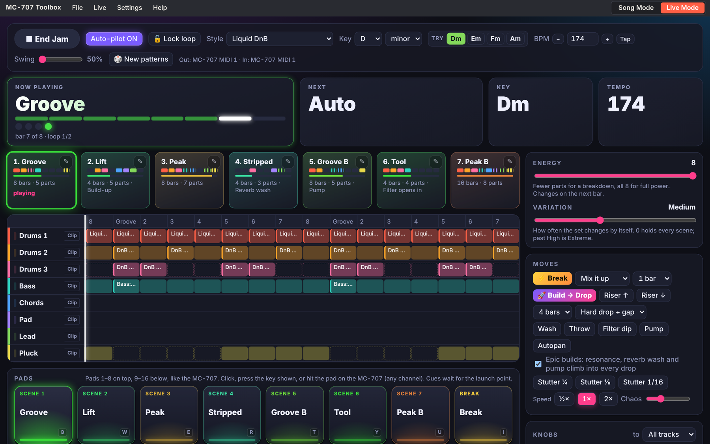
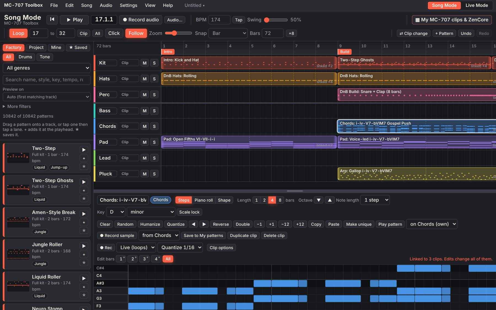
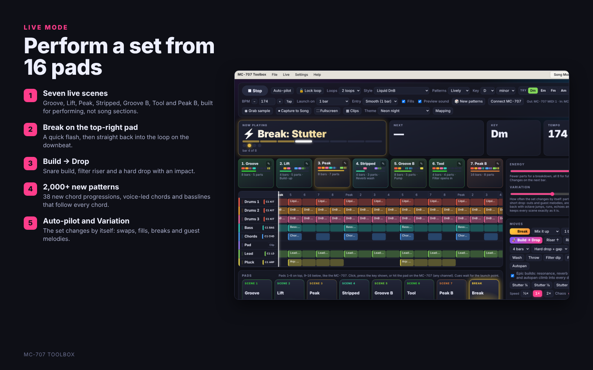
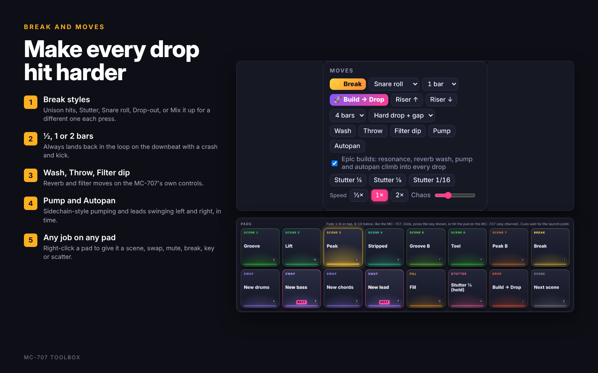
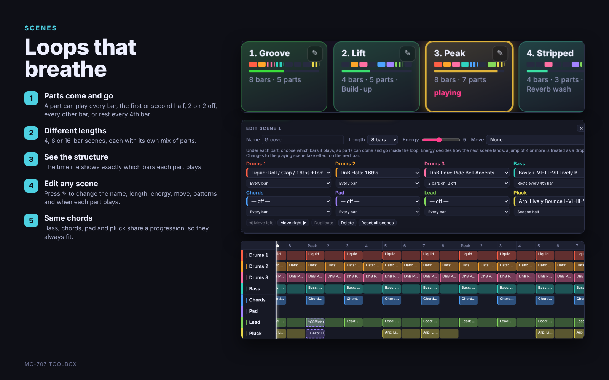
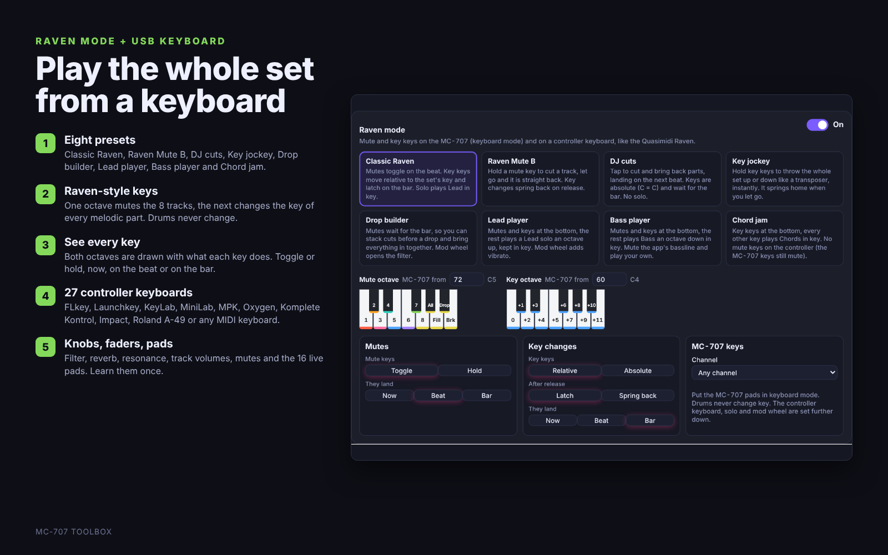
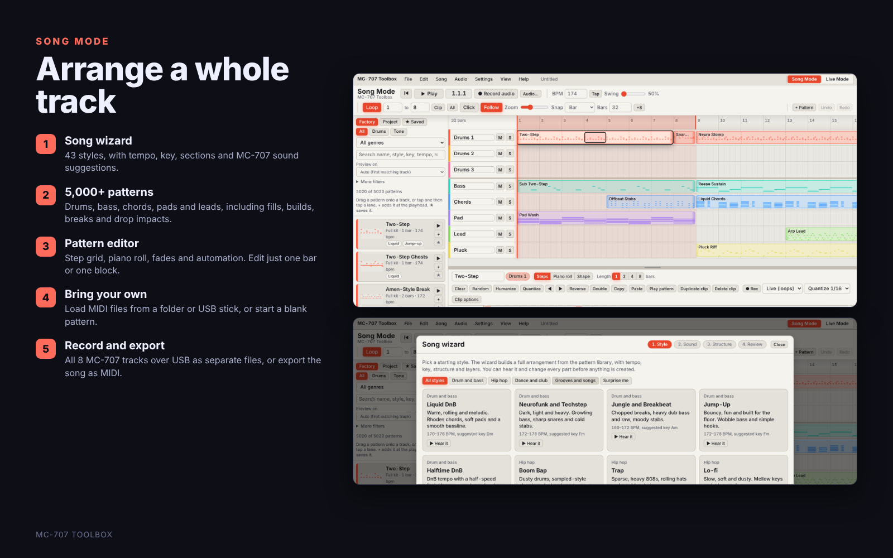
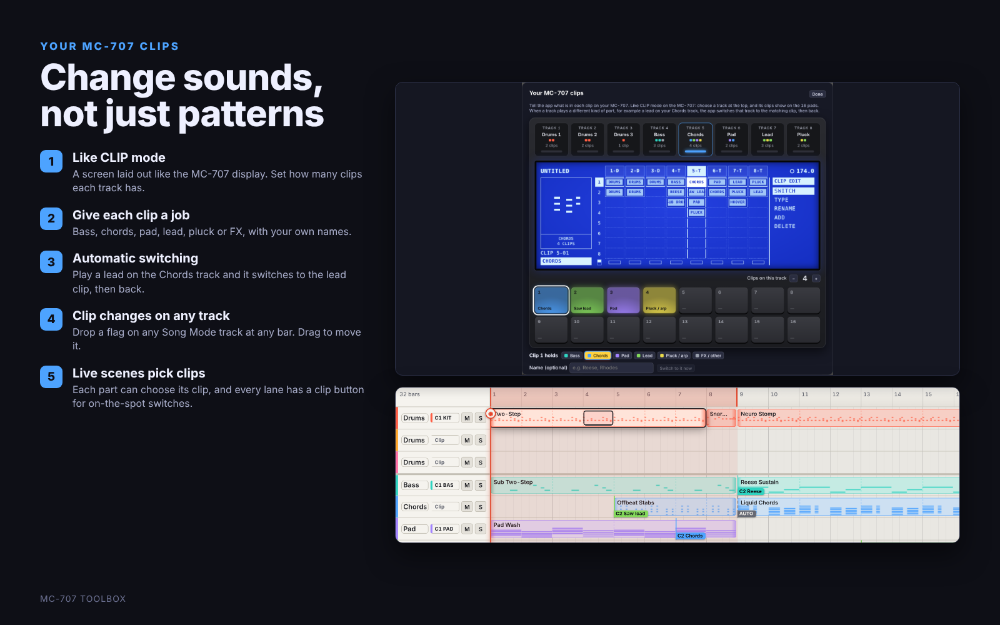
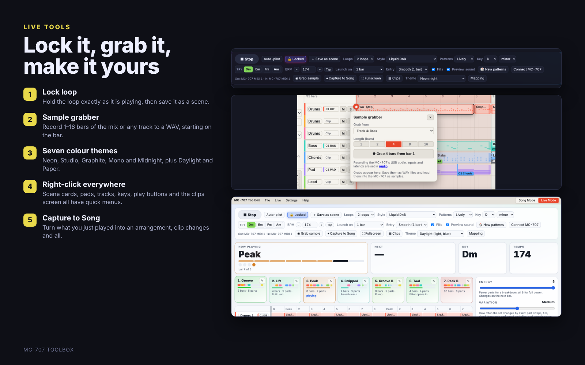

# MC-707 Toolbox

Arrange full songs and perform live sets for the **Roland MC-707** from your computer. The app plays all eight MC-707 tracks over one USB cable, and can record the audio coming back.

It has two modes, switched with the tabs at the top right:

- **Song Mode** – build a whole track on a timeline, then play it on the MC-707 note for note.
- **Live Mode** – a looping set of scenes you perform from 16 pads, with drops, breaks, swaps and effects that land on the beat.

> **Beta.** Free to use and share, not for sale (see [Licence](#licence)). This is an unofficial fan project and is not made by or affiliated with Roland.

**Try it:** open the [web version](https://mendo-707.github.io/mc707-toolbox/) in Chrome or Edge, or download the Windows app from [Releases](../../releases).




<details>
<summary><b>Feature overview (7 cards)</b></summary>









</details>

### MC-101 mode (beta)

Got an MC-101? Choose **Settings › Device: MC-101 (4 tracks)**. The app switches to the MC-101's four tracks: **Drums, Bass, Chords and Lead** on MIDI channels 1–4. Its 16 pads are laid out like the MC-707's (1–8 on top, 9–16 below), so the Live pads work the same way. Drums play **full kits** (kick, snare, hats and percussion in one pattern), so one drum track still sounds complete. The song wizard, Live Mode scenes, breaks, builds and drops all work with the four tracks. MC-101 mode hasn't been tested on hardware yet: if you try it, run **Live › Mapping › Pad test** and send the result in an issue.

### Full kits on the MC-707

**Settings › Drums on one track (full kits)** puts the whole groove on Drums 1, which frees Drums 2 for another sound. Drums 3 keeps the builds and drop impacts. Over 1,100 full-kit patterns are built from the library's kits, hats and percussion.

---

## Getting started

### Windows app (recommended)

**Download:** get `MC-707-Toolbox.exe` from [Releases](../../releases). It is one portable file with no installer.

**Or build it yourself:**

1. Install **Node.js LTS** from <https://nodejs.org> (accept the defaults).
2. Double-click **`build-exe.bat`** in this folder and wait 2–5 minutes.
3. Your app is **`dist\MC-707-Toolbox.exe`**. It is one portable file with no installer, so copy it anywhere.

The first time you open it, Windows may say *"Windows protected your PC"*. That appears for any app that is not code-signed. Click **More info**, then **Run anyway**.

If the build fails, the details are in `build-log.txt` next to the script.

### In a browser

Open the [web version](https://mendo-707.github.io/mc707-toolbox/), or download `index.html` and open it, in **Chrome or Edge**. Everything works except real folders and Save As dialogs, which need the Windows app. Firefox and Safari don't support Web MIDI.

### Connect the MC-707

1. Plug the MC-707 into the computer by USB.
2. Open **Settings › Quick setup** and press **Auto-connect MC-707**.
3. Press **Play tracks 1 → 8**. Each MC-707 track should sound in turn. If one is wrong, change its channel there.
4. Optional: tick **Make the MC-707 follow this app** to send MIDI clock and start/stop. On the MC-707, set sync to AUTO or USB.

---

## Song Mode

| Feature | What it does |
|---|---|
| **Song wizard** | Pick one of 43 styles (drum and bass, hip hop, house, techno and more), hear every part at the style's own tempo, and get a full arrangement with tempo, key and sections. It draws on the whole library for the style, keeps bass, chords, pads and arps on the same chord progression, adds fills, a build before each big section and an impact on the drop, and suggests MC-707 factory tones for every track. |
| **Pattern library** | More than 5,000 drum and tone patterns, including fills, builds and drop impacts for every genre, and 810 lively basslines, arps, chord rhythms and call-and-response leads. A variety pack adds 2,160 more chord, bass, pad and arp patterns on 38 new progressions: borrowed chords, line clichés, Phrygian and Dorian vamps, 8-bar journeys, two chords to a bar, pedal points and sus chords that resolve. Chords are voice-led (each one moves as little as possible from the last), with rhythms from clave, tresillo, gates, pushes and top-line melodies. Basslines follow each chord's own third and seventh, approach the next chord by a half step and add turnarounds. A genre pack brings authentic grooves: trap kits in three producer flavours (dark and sparse, bouncy with snaps and open hats, busy with rolling keys), drill with its late snare and 3-3-2 hats, halftime drum and bass, Amen jungle breaks, afrobeats and phonk, all with real hi-hat rolls (16th triplets, 32nds and 64ths placed between the grid steps), plus sliding 808s, dark bells, piano runs, organ and plucks for trap and drill. The 808 slides overlap the next note, so set the MC-707 tone to mono with legato and portamento on to hear them glide. Drag them onto 3 drum tracks and 5 tone tracks, filter by genre, role, key and length, and star favourites. |
| **+ Pattern** | Create a blank drum or tone pattern, or **load MIDI files** from any folder or USB drive (or drop `.mid` files on the arranger). Channel 10 parts become drums automatically. |
| **Pattern editor** | Step grid, piano roll and fade/automation shapes. Use **Edit bars** to pick a bar or range and change only that block. **Repeat to end** copies it through the pattern. |
| **Edit one block** | Long clips show dashed lines where the pattern repeats. Hover to see the block, then **double-click** it (or right-click › Edit … on its own) to give just that repeat its own copy and open it in the editor. The other repeats stay as they were. |
| **Glue** | Join clips that touch on a track back into one clip: right-click › **Glue to the next clip**, or select a clip and press **G** to glue everything touching it. Fades, velocity and transpose are kept. If the result repeats it becomes a short looping pattern again, and if nothing was changed it relinks to the original pattern. Up to 32 bars at a time. |
| **Linked clips** | Clips can share a pattern. Edit once and every copy changes, or use **Make unique** to split one off. |
| **Structure and transpose** | Copy, paste, repeat, insert and delete whole sections. Transpose the song or just part of it. |
| **Scene and clip changes** | Markers can switch MC-707 scenes, and clips can switch MC-707 clips, using program change. |
| **Clip changes on every track** | Right-click a track lane › **MC-707 clip change at bar …** to drop a flag that switches that MC-707 track to one of its clips (by name and kind, from **Your MC-707 clips**). Drag a flag to move it, click it to change or delete it. A section marker's menu can set clips for every track at once. Each track header shows which clip the track is on, and playing from the middle of the song switches every track to the right clip first. |
| **Lock loop** | In Live Mode, **🔒 Lock loop** holds the loop exactly as it is playing: the same patterns on every track, and no auto-pilot, variation or guest parts leaving. Your own pad presses still work. **＋ Save as scene** keeps that exact loop on a scene pad. It is also a pad action. |
| **Sample grabber** | The **◉** on the Song Mode playhead (and **◉ Grab sample** in Live Mode) records 1–16 bars of the mix, one track or Ext In to a WAV, starting on the bar line. While playing it grabs from the next bar; when stopped it plays from the playhead. It uses the MC-707's per-track USB audio set up in Audio, or the app's own sound with that track soloed. Play the grabs back, then save them and load them into the MC-707 as samples. |
| **Preview on any tone track** | Each tone pattern in the library previews on the track that suits it (bass on Bass, leads on Lead …). The **→n** button next to ▶ picks any tone track instead. The pattern editor's **Play pattern** can also play a clip through another tone track's sound. |
| **Raven presets** | Eight one-tap setups: Classic Raven, Raven Mute B, DJ cuts, Key jockey, Drop builder, Lead player, Bass player and Chord jam. The Raven area shows both MC-707 octaves as keyboards labelled with what each key does, with mute and key options as simple toggles. More controller keyboards are listed too (Launchkey Mini, MiniLab 3, KeyLab 88, MPK Mini Plus, Oxygen Pro, Keystation, Komplete Kontrol, Impact LX, Roland A-49). |
| **Right-click everywhere** | Right-click for quick options. **Song Mode:** the Play button (play from the start or a section, loop, metronome, record, grab), Play pattern (play on another track, loop one bar, grab it as a sample), the sample grabber (quick 1–16 bar grabs, choose the source) and the clip chips. **Live Mode:** scene cards (launch on the next bar, drop into it, rename, energy, length, move, duplicate, replace with the loop playing now, reorder, delete), pads (trigger, or give the pad any job, plus break style and length on the Break pad), track names, lanes and mute buttons (mute, mute everything else, new or chosen pattern, stop the part, MC-707 clip) and key buttons (minor or major, up a fifth, relative key). **Clips screen:** any pad or screen cell (set the kind of sound, rename, switch now, duplicate, remove). |
| **Record audio** | Two clear choices. **2 channels, stereo mix:** one stereo file from the MC-707's mix or any audio interface, with optional stems made by playing each track on its own. **8 channels, every track:** the mix plus each MC-707 track as its own stereo file, recorded at the same time over USB. Windows shows the MC-707 either as one 20-channel input (1–2 Mix, 3–4 Track 1 … 17–18 Track 8, 19–20 Ext In) or as separate inputs per track; each track can pick its own input and channels, and **Match by name** sets them up for you. **Check each track** plays a note on each MC-707 track and finds where it arrives. Saves WAV or MP3. |
| **Export MIDI** | A `.zip` with the whole song plus one `.mid` per track. |

## Live Mode

| Feature | What it does |
|---|---|
| **Scenes** | Seven loops built for performing rather than song sections: Groove, Lift, Peak, Stripped, Groove B, Tool and Peak B. Each uses a different mix of parts and its own length (4, 8 or 16 bars), and parts don't all play all the time: some come in for the second half, play 2 bars on and 2 off, or rest every 4th bar, so the loop breathes. Each set draws from the whole library for the genre, and bass, chords, pads and plucks share the same chord progression. A jump of 4 or more in energy (Lift → Peak, Tool → Peak B) lands as a drop. |
| **16 pads** | Two rows of 8, laid out like the MC-707. Pads 1–7 across the top hold the scenes and pad 8 (top right) is **Break**. Pads 9–16 below hold the Drums, Bass, Chords and Lead swaps, Fill, Stutter, Build → Drop and Next scene. Select any drum track on the MC-707 and its pads work straight away: the app knows the drum notes they send, so the pad you hit lights up in the same spot on screen. To check yours, use **Mapping › Pad test**. You can also play the pads by mouse or computer keyboard (`Q`–`I` top row, `A`–`K` bottom row), and change any pad in **Mapping**. |
| **Build → Drop** | A snare, clap or tom build on Drums 3 that doubles in speed to a roll, a filter riser, kick and bass cut for the last bar, an optional beat of silence, then the drop slams in with a crash-and-kick impact. Choose 2, 4 or 8 bars, and **Hard drop + gap**, **Hard drop** or **Smooth drop**. Big jumps cued from a pad or by Auto-pilot get the same treatment. |
| **Break** | The top-right pad: a quick, exciting flash, then straight back into the loop on the downbeat with a crash and kick. **Unison hits** (every part hits the same rhythm), **Stutter** (the beat chops faster and faster as the filter opens), **Snare roll** (everything cuts to an accelerating roll), **Drop-out** (kick and bass vanish under a reverb wash and a roll) or **Mix it up** for a different one each time. Choose ½, 1 or 2 bars. Auto-pilot and Variation throw breaks in too. |
| **Edit scenes** | Press ✎ on any scene to change its name, length (1–32 bars), energy, the pattern on each track and which bars each part plays, give it a move, and reorder, duplicate or delete it. Your scenes are kept until you press **New set** or **Reset all scenes**. |
| **Moves** | Sound-design moves on the MC-707's own controls, the tricks producers use to make drops hit harder. During every build, resonance climbs, the reverb washes up, the tone parts pump harder and faster (sidechain feel), and the lead pans wider. All of it snaps back the moment the drop lands. Untick **Epic builds** to turn this off. Buttons for **Wash**, **Throw**, **Filter dip**, **Pump** and **Autopan** work any time, and each scene can have its own move. |
| **Risers, stutter, speed** | Filter sweeps over 2, 4 or 8 bars. Hold to repeat a ¼, ⅛ or 1/16 slice. Play at ½×, 1× or 2×. |
| **Patterns** | **Lively** (default) picks busier, syncopated parts; **Mixed** uses everything; **Classic** keeps parts simple. The song wizard has the same choice. |
| **Variation** | How often the set changes by itself: part swaps, fills, one-bar drop-outs and guest melodies, and repeats come back with octave jumps, runs, echoes and ghost notes. At High, changes come every 2 bars. Past High is **Extreme**: every repeat changes, with hi-hat rolls that suit the style (16th triplets and 64th ramps in trap, drill and phonk; 32nds elsewhere), snare rolls, kick drop-outs and 808 octave flicks. 0 keeps each scene as it is. |
| **Key and scale** | Change the key and switch between **minor and major** at any time. Next to the key, **Try** shows the keys that suit the style; tap one to switch. Melodic parts are converted on the next bar. Capture to Song keeps the change. |
| **Energy** | One slider from a sparse breakdown to all 8 parts. |
| **Auto-pilot** | Runs the set by itself, with a Chaos amount for how often it adds fills and swaps. |
| **Knobs, XY pad, Scatter** | Send the MC-707's FILTER, MOD, FX and SOUND knobs (CC 80–83), drag the XY pad, and hold the 16 Scatter pads. |
| **Raven mode** | Inspired by the Quasimidi Raven: one octave of keys changes the key of every melodic part (drums never change), and another mutes and unmutes the 8 tracks. The 4 keys above the mutes are Unmute all, Fill, Build → Drop and Break. Mutes can toggle or work only while held (like the Raven's Mute B), and land straight away, on the beat or on the bar. Key keys can be absolute (C = key of C) or relative like the Raven (C = the set's own key), and can latch or snap back when released. Works from the MC-707's keys and from a controller keyboard. |
| **Controller keyboard** | Plug in a USB MIDI keyboard as well as the MC-707, such as a Novation FLkey or Launchkey, an Arturia KeyLab or an Akai MPK, or any other model. Pick it in **Mapping › Controller keyboard** and choose its model. The lowest octave mutes, the next changes key, and every key above plays a live solo on the MC-707 track you choose (with optional scale lock and octave shift). The pitch wheel bends the solo; the mod wheel opens the filter. Knobs control FILTER, MOD, FX, SOUND, reverb, resonance, Variation and Chaos; faders set each track's volume and the energy; fader buttons mute tracks; and the keyboard's pads can play the 16 live pads. Press **Learn all controls in order** once to match your keyboard. |
| **Capture to Song** | Turns what you just played into a Song Mode arrangement, with a marker for each scene. |
| **Visualizer** | A synthwave scene that reacts to the notes as they play. |
| **Your MC-707 clips** | **Settings › Your MC-707 clips** (or **▦ Clips** in Live Mode) shows the MC-707 the way CLIP mode does: pick a track, and its clips light up on the 16 pads. Set how many clips each track has and what each one holds (Bass, Chords, Pad, Lead, Pluck/arp, FX). Turn on automatic switching and a track jumps to the matching clip when it plays a different kind of part (a lead on your Chords track, say), then back. Live Mode's B scenes use those extra sounds, and the scene editor offers them. Each Live scene part can also pick the clip it plays on, the clip button on each Live lane switches a track on the spot, and **Capture to Song** turns those switches into clip-change flags. Use clips that hold a sound but no notes. |
| **Themes** | Pick a colour theme next to Fullscreen: Neon night, Studio (teal and amber), Graphite (orange), Mono (lime) and Midnight (blue and coral), or the light themes Daylight (blue) and Paper (orange). Scene colours, buttons and the visualizer all follow it. |
| **Stage ready** | **F11** for fullscreen, and the screen stays awake while music is playing (turn this off in the Live or View menu). |

---

## Files and folders (Windows app)

| What | Where |
|---|---|
| Projects | `Documents\MC-707 Toolbox\Projects` |
| Recordings | `Documents\MC-707 Toolbox\Recordings` |

Change either folder from the **File** menu. Work also autosaves inside the app. Use **File › Save** (Ctrl+S) to keep a project file you can back up or share.

## Keyboard shortcuts

| Key | Song Mode | Live Mode |
|---|---|---|
| Space | Play / stop | Start / stop |
| `A`–`K` / `Q`–`I` | – | Bottom / top row of pads (hold for stutter) |
| Ctrl+S / Ctrl+Shift+S | Save / Save as | Save / Save as |
| Ctrl+O | Open project | Open project |
| Ctrl+Z / Ctrl+Shift+Z | Undo / redo | – |
| Ctrl+D | Duplicate clip | – |
| F11 | Fullscreen | Fullscreen |

More are listed under **Help › Shortcuts and tips**.

---

## Good to know

- **Stuck notes:** the app sends *All Notes Off* when you stop, switch modes or close it.
- **Pad notes:** with a drum track selected, the MC-707 pads send drum notes on that track's channel: top row 37 39 42 46 49 51 54 56, bottom row 36 38 41 45 48 62 63 64. If nothing arrives, hold SHIFT and press the track's TRACK SEL button, open the MIDI page and turn **TxMIDI Note** ON with output to USB. **Mapping › Pad test** shows exactly what your pads send.
- **Moves and rest values:** moves use CC 71 (resonance), CC 91 (reverb send), CC 11 (expression) and CC 10 (pan), and return each one to its rest value. Set **Reverb rest** in Mapping to the reverb send your tracks normally use.
- **Knob rest values:** where FILTER and FX return after the XY pad or a riser can be set in **Mapping**.
- **Song position:** the MC-707 does not follow MIDI song position, so starting playback mid-song does not move the MC-707's own sequencer.
- **Privacy:** no accounts, no tracking, and nothing you make is sent over the internet. The fonts, and the MP3 encoder in the browser version, load from public CDNs. The Windows app bundles the encoder.
- **Background playback:** timing keeps running when the window is minimised or behind another app.

## Project layout

```
index.html      the whole app in one file, built from src/ (do not edit it directly)
src/            the source: about 90 JavaScript modules, the page markup and the styles
scripts/        build, development server and code checks
tests/          automated tests (Playwright, with a simulated MC-707)
main.js         Windows app window, file dialogs, folders, keep-awake
preload.js      the small bridge the page uses to reach those features
package.json    app name, version and build settings (Electron + electron-builder)
build-exe.bat   one-click build for Windows
docs/           ARCHITECTURE.md, plus the screenshots and feature cards used in this README
AGENTS.md       how to work on the code (for people and coding agents)
LICENSE.md      PolyForm Noncommercial 1.0.0
.github/        runs the tests on every push, and builds the Windows app for each release
```

**Working on the code:** read [AGENTS.md](AGENTS.md) first, then [docs/ARCHITECTURE.md](docs/ARCHITECTURE.md). In short: `npm run tools` once, `npm run dev` to work on `src/` in the browser, `npm run build` to make `index.html`, and `npm test` before committing. Developers can also run `npm install` and then `npm start` to launch the Windows app without building the exe.

---

## Reporting problems

Open an [issue](../../issues) and say what you pressed, what you expected and what happened. Your Windows version and MC-707 firmware version help. Some newer features (20-channel recording, the Break pad and controller keyboards) have only been tested against a simulated MC-707 so far, so reports from real hardware are very welcome.

## Licence

MC-707 Toolbox is free to use, share and change for any **noncommercial** purpose under the [PolyForm Noncommercial License 1.0.0](LICENSE.md). You may not sell it, charge for it or use it commercially. If you share a copy or a changed version, include the licence and its Required Notice line.

Roland and MC-707 are trademarks of Roland Corporation. This project is not made by, endorsed by or affiliated with Roland. Sound names in the wizard's suggestions refer to the MC-707's factory sounds; no Roland sounds or samples are included.
