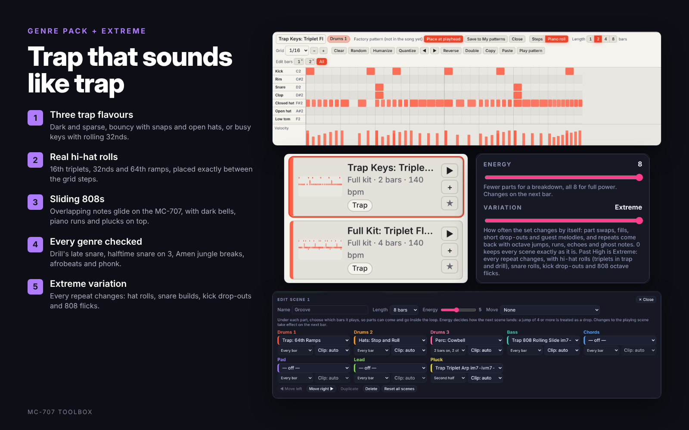
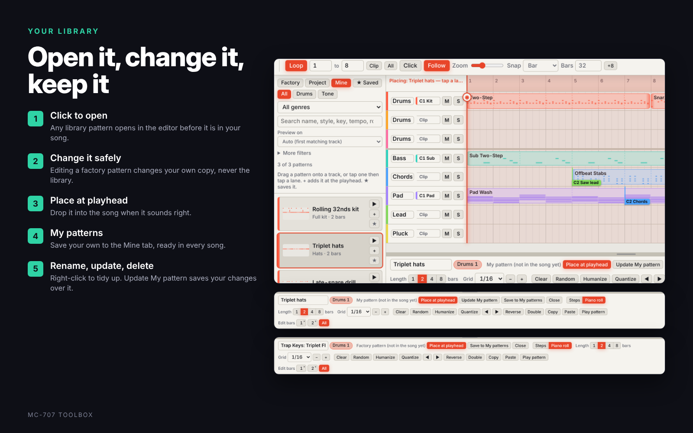

# MC-707 Toolbox

Arrange full songs and perform live sets for the **Roland MC-707** from your computer. The app plays all eight MC-707 tracks over one USB cable, and can record the audio coming back.

It has two modes, switched with the tabs at the top right:

- **Song Mode** – build a whole track on a timeline, then play it on the MC-707 note for note.
- **Live Mode** – a looping set of scenes you perform from 16 pads, with drops, breaks, swaps and effects that land on the beat.

And a **ZenCore editor** for the sounds in your MC-707's clips.

> **Version 1.2.** Free to use and share, not for sale (see [Licence](#licence)). This is an unofficial fan project and is not made by or affiliated with Roland.

**Try it:** open the [web version](https://mendo-707.github.io/mc707-toolbox/) in Chrome or Edge, or download the Windows app from [Releases](../../releases).


<details>
<summary><b>Feature overview (9 cards)</b></summary>





</details>

### MC-101 mode (beta)

Got an MC-101? Choose **Settings › Device: MC-101 (4 tracks)**. The app switches to the MC-101's four tracks: **Drums, Bass, Chords and Lead** on MIDI channels 1–4. Its 16 pads are laid out like the MC-707's (1–8 on top, 9–16 below), so the Live pads work the same way. Drums play **full kits** (kick, snare, hats and percussion in one pattern), so one drum track still sounds complete. The song wizard, Live Mode scenes, breaks, builds and drops all work with the four tracks. MC-101 mode hasn't been tested on hardware yet: if you try it, run **Live › Mapping › Pad test** and send the result in an issue.

### Track setup

**Settings › Track setup** lets you choose how the 8 tracks are split, from **8 drum tracks to 8 tone tracks** and anything in between. Pick a ready-made split (3 drums + 5 tone is the default, then 8 drums, 6 + 2, 4 + 4, 2 + 6, 1 + 7 and 8 tone), or set each track's job yourself: **kit, hats or perc** for drum tracks, **bass, chords, pad, lead, pluck or acid** for tone tracks. The song wizard and Live Mode follow it, so a second kit track gets its own grooves and a second lead gets its own line. Clips that no longer fit a track (a drum clip on a track that is now a tone track) are removed, and Undo brings them back. On the MC-707, load a drum kit on each drum track and a tone on each tone track to match.

### Full kits on the MC-707

**Settings › Drums on one track (full kits)** puts the whole groove on Drums 1, which frees Drums 2 for another sound. Drums 3 keeps the builds and drop impacts. Over 1,100 full-kit patterns are built from the library's kits, hats and percussion.

---

## Getting started

### Windows app (recommended)

**Download** from [Releases](../../releases):

- **`MC-707-Toolbox-Setup.exe`** (recommended): the installer. It adds MC-707 Toolbox to the Start menu and the desktop, lets you choose the folder, and opens faster than the portable app. Uninstall it from Windows **Settings › Apps**. Install a newer version over the top; your songs, settings and My patterns stay.
- **`MC-707-Toolbox.exe`**: the portable app. No install: one file you can run from anywhere, such as a USB stick.

Both keep their saved work in the same place, so you can switch between them.

**Or build it yourself:**

1. Install **Node.js LTS** from <https://nodejs.org> (accept the defaults).
2. Double-click **`build-exe.bat`** in this folder and wait 2–5 minutes.
3. In the **`dist`** folder you get **`MC-707-Toolbox-Setup.exe`** (the installer) and **`MC-707-Toolbox.exe`** (the portable app).

The first time you open either one, Windows may say *"Windows protected your PC"*. That appears for any app that is not code-signed. Click **More info**, then **Run anyway**.

If the build fails, the details are in `build-log.txt` next to the script.

### In a browser

Open the [web version](https://mendo-707.github.io/mc707-toolbox/), or download `index.html` and open it, in **Chrome or Edge**. Everything works except real folders and Save As dialogs, which need the Windows app. Firefox and Safari don't support Web MIDI.

### Connect the MC-707

1. Plug the MC-707 into the computer by USB.
2. Open **Settings › Quick setup** and press **Auto-connect MC-707**.
3. Press **Play tracks 1 → 8**. Each MC-707 track should sound in turn. If one is wrong, change its channel there.
4. Optional: tick **Make the MC-707 follow this app** to send MIDI clock and start/stop. On the MC-707, set sync to AUTO or USB.
5. On the MC-707 (SHIFT + KNOB ASSIGN › SET › MIDI tab), set **MIDI Rx Auto Channel** to **OFF** and **Track Channel 1-8** to CH1–CH8. Quick setup lists every setting that matters, step by step.

---

## Opening the app

The app opens in Song Mode with a start screen: **Load last session**, **Blank song**, **Empty template** (64 bars with intro, build, drop, break, drop 2 and outro marked), **Song wizard** or **Live Mode**. Untick *Show this when the app opens* to skip it; **File › Start screen** brings it back. Live Mode opens with a genre picker: choose a style for a fresh set, or keep the one you had (**Live › Pick a genre** any time).

## Song Mode

| Feature | What it does |
|---|---|
| **Song wizard** | Pick one of 41 styles (drum and bass, hip hop, house, techno and more), hear every part at the style's own tempo, and get a full arrangement with tempo, key and sections. It draws on the whole library for the style, keeps bass, chords, pads and arps on the same chord progression, adds fills, a build before each big section and an impact on the drop, and suggests MC-707 factory tones for every track. |
| **Pattern library** | More than 5,000 drum and tone patterns, including fills, builds and drop impacts for every genre, and 810 lively basslines, arps, chord rhythms and call-and-response leads. A groove pack adds 844 parts on modal progressions (Dorian vamps, Mixolydian and Lydian lifts, Phrygian and harmonic-minor darkness, blues) in each genre's groovy keys and rhythms, plus 60 new drum grooves. A variety pack adds 2,160 more chord, bass, pad and arp patterns on 38 new progressions: borrowed chords, line clichés, Phrygian and Dorian vamps, 8-bar journeys, two chords to a bar, pedal points and sus chords that resolve. Chords are voice-led (each one moves as little as possible from the last), with rhythms from clave, tresillo, gates, pushes and top-line melodies. Basslines follow each chord's own third and seventh, approach the next chord by a half step and add turnarounds. A genre pack brings authentic grooves: trap kits in three producer flavours (dark and sparse, bouncy with snaps and open hats, busy with rolling keys), drill with its late snare and 3-3-2 hats, halftime drum and bass, Amen jungle breaks, afrobeats and phonk, all with real hi-hat rolls (16th triplets, 32nds and 64ths placed between the grid steps), plus sliding 808s, dark bells, piano runs, organ and plucks for trap and drill. The 808 slides overlap the next note, so set the MC-707 tone to mono with legato and portamento on to hear them glide. Drag them onto 3 drum tracks and 5 tone tracks, filter by genre, role, key and length, and star favourites. |
| **+ Pattern** | Create a blank drum or tone pattern, or **load MIDI files** from any folder or USB drive (or drop `.mid` files on the arranger). Channel 10 parts become drums automatically. |
| **Pattern editor** | Step grid, piano roll and fade/automation shapes. Use **Edit bars** to pick a bar or range and change only that block. **Repeat to end** copies it through the pattern. Click any pattern in the library to open it in the editor: play it, change it, then **Place at playhead**. Editing a factory pattern changes your own copy, never the library. **● Record sample** records the pattern on its own to a WAV, played through the track you pick next to it (its own USB channel when Audio has per-track channels, otherwise the mix); the grabber opens with it ready to save. |
| **My patterns** | **Save to My patterns** in the editor keeps a pattern in your own library (the **Mine** tab), ready in every song. Right-click one to rename or delete it; when you open one, **Update My pattern** saves your changes over it. |
| **Edit one block** | Long clips show dashed lines where the pattern repeats. Hover to see the block, then **double-click** it (or right-click › Edit … on its own) to give just that repeat its own copy and open it in the editor. The other repeats stay as they were. |
| **Glue** | Join clips that touch on a track back into one clip: right-click › **Glue to the next clip**, or select a clip and press **G** to glue everything touching it. Fades, velocity and transpose are kept. If the result repeats it becomes a short looping pattern again, and if nothing was changed it relinks to the original pattern. Up to 32 bars at a time. |
| **Linked clips** | Clips can share a pattern. Edit once and every copy changes, or use **Make unique** to split one off. |
| **Structure and transpose** | Copy, paste, repeat, insert and delete whole sections. Transpose the song or just part of it. |
| **Scene and clip changes** | Markers can switch MC-707 scenes, and clips can switch MC-707 clips, using program change. |
| **Clip changes on every track** | Press **K** or **⇄ Clip change** to insert a clip change at the playhead, **Shift+K** to flip the selected clip's track straight back to the clip it was on before, or **Alt+click** a lane. **Switch back and forth** sets two clips to alternate every 1, 2, 4 or 8 bars through the loop. Right-click a track lane › **Insert MC-707 clip change at bar …** also drops a flag that switches that MC-707 track to one of its clips (by name and kind, from **Your MC-707 clips**). Drag a flag to move it, click it to change or delete it. A section marker's menu can set clips for every track at once. Each track header shows which clip the track is on, and playing from the middle of the song switches every track to the right clip first. |
| **Lock loop** | In Live Mode, **🔒 Lock loop** holds the loop exactly as it is playing: the same patterns on every track, and no auto-pilot, variation or guest parts leaving. Your own pad presses still work. **＋ Save as scene** keeps that exact loop on a scene pad. It is also a pad action. |
| **Sample grabber** | The **◉** on the Song Mode playhead (and **◉ Grab sample** in Live Mode) records 1–16 bars of the mix, one track or Ext In to a WAV, starting on the bar line. While playing it grabs from the next bar; when stopped it plays from the playhead. It uses the MC-707's per-track USB audio set up in Audio, or the app's own sound with that track soloed. Play the grabs back, then save them and load them into the MC-707 as samples. |
| **Preview on any tone track** | Each tone pattern in the library previews on the track that suits it (bass on Bass, leads on Lead …). The **→n** button next to ▶ picks any tone track instead. The pattern editor's **Play pattern** can also play a clip through another tone track's sound. |
| **Raven presets** | Eight one-tap setups: Classic Raven, Raven Mute B, DJ cuts, Key jockey, Drop builder, Lead player, Bass player and Chord jam. The Raven area shows both MC-707 octaves as keyboards labelled with what each key does, with mute and key options as simple toggles. More controller keyboards are listed too (Launchkey Mini, MiniLab 3, KeyLab 88, MPK Mini Plus, Oxygen Pro, Keystation, Komplete Kontrol, Impact LX, Roland A-49). |
| **Right-click everywhere** | Right-click for quick options. **Song Mode:** the Play button (play from the start or a section, loop, metronome, record, grab), Play pattern (play on another track, loop one bar, grab it as a sample), the sample grabber (quick 1–16 bar grabs, choose the source) and the clip chips. **Live Mode:** scene cards (launch on the next bar, drop into it, rename, energy, length, move, duplicate, replace with the loop playing now, reorder, delete), pads (trigger, or give the pad any job, plus break style and length on the Break pad), track names, lanes and mute buttons (mute, mute everything else, new or chosen pattern, stop the part, MC-707 clip) and key buttons (minor or major, up a fifth, relative key). **Clips screen:** any pad or screen cell (set the kind of sound, rename, switch now, duplicate, remove). |
| **Record audio** | Two clear choices. **2 channels, stereo mix:** one stereo file from the MC-707's mix or any audio interface, with optional stems made by playing each track on its own. **8 channels, every track:** the mix plus each MC-707 track as its own stereo file, recorded at the same time over USB. Windows shows the MC-707 either as one 20-channel input (1–2 Mix, 3–4 Track 1 … 17–18 Track 8, 19–20 Ext In) or as separate inputs per track; each track can pick its own input and channels, and **Match by name** sets them up for you. **Check each track** plays a note on each MC-707 track and finds where it arrives. Saves WAV or MP3. |
| **Export MIDI** | A `.zip` with the whole song plus one `.mid` per track. |

## Live Mode

| Feature | What it does |
|---|---|
| **Start Jam and End Jam** | **▶ Start Jam** opens with a few 2-bar intro loops made from the first scene's own parts (drums first, keys first or bass first, picked at random): the filter opens and the last loop rolls and rises into the drop. **■ End Jam** ends it quickly from the next bar: straight to a last hit, one thinned-out bar and the hit, or a 2-bar fade. Press it again to stop straight away. Shift-click Start Jam to skip the intro. A scene pad during the intro or outro takes over. |
| **Swing** | A Swing slider next to the tempo, from straight (50%) to heavy shuffle (75%), changes the groove straight away. |
| **Scenes** | Seven loops built for performing rather than song sections: Groove, Lift, Peak, Stripped, Groove B, Tool and Peak B. Each uses a different mix of parts and its own length (4, 8 or 16 bars), and parts don't all play all the time: some come in for the second half, play 2 bars on and 2 off, or rest every 4th bar, so the loop breathes. Each set draws from the whole library for the genre, and bass, chords, pads and plucks share the same chord progression. A jump of 4 or more in energy (Lift → Peak, Tool → Peak B) lands as a drop. |
| **16 pads** | Two rows of 8, laid out like the MC-707. Pads 1–7 across the top hold the scenes and pad 8 (top right) is **Break**. Pads 9–16 below hold the Drums, Bass, Chords and Lead swaps, Fill, Stutter, Build → Drop and Next scene. Select any drum track on the MC-707 and its pads work straight away: the app knows the drum notes they send, so the pad you hit lights up in the same spot on screen. To check yours, use **Mapping › Pad test**. You can also play the pads by mouse or computer keyboard (`Q`–`I` top row, `A`–`K` bottom row), and change any pad in **Mapping**. |
| **Build → Drop** | A snare, clap or tom build on Drums 3 that doubles in speed to a roll, a filter riser, kick and bass cut for the last bar, an optional beat of silence, then the drop slams in with a crash-and-kick impact. Choose 2, 4 or 8 bars, and **Hard drop + gap**, **Hard drop** or **Smooth drop**. Big jumps cued from a pad or by Auto-pilot get the same treatment. |
| **Break** | The top-right pad: a quick, exciting flash, then straight back into the loop on the downbeat with a crash and kick. **Unison hits** (every part hits the same rhythm), **Stutter** (the beat chops faster and faster as the filter opens), **Snare roll** (everything cuts to an accelerating roll), **Drop-out** (kick and bass vanish under a reverb wash and a roll) or **Mix it up** for a different one each time. Choose ½, 1 or 2 bars. Auto-pilot and Variation throw breaks in too. |
| **New patterns** | **🎲 New patterns** while playing drops to the drums from the next bar, the new set's drums take over halfway, and its first scene comes in after 2 to 6 bars, so the music never stops. |
| **Acid** | 303-style acid lines (16ths with accents, slides and octave jumps) for techno, acid techno, house, trance, electro, breakbeat and drum and bass. Mark a clip as **Acid** on the clips screen and Live Mode plays them on it; they are also in the library under Acid lines. |
| **Edit scenes** | Press ✎ on any scene to change its name, length (1–32 bars), energy, the pattern on each track and which bars each part plays, give it a move, and reorder, duplicate or delete it. Your scenes are kept until you press **New set** or **Reset all scenes**. |
| **Moves** | Sound-design moves on the MC-707's own controls, the tricks producers use to make drops hit harder. During every build, resonance climbs, the reverb washes up, and the tone parts pump harder and faster (sidechain feel). All of it snaps back the moment the drop lands. Untick **Epic builds** to turn this off. Buttons for **Wash**, **Throw**, **Filter dip**, **Pump** and **Autopan** work any time, and each scene can have its own move. |
| **Risers, stutter, speed** | Filter sweeps over 2, 4 or 8 bars. Hold to repeat a ¼, ⅛ or 1/16 slice. Play at ½×, 1× or 2×. |
| **Patterns** | **Lively** (default) picks busier, syncopated parts; **Mixed** uses everything; **Classic** keeps parts simple. The song wizard has the same choice. This and the other playback options (loops per scene, launch on, entry, fills, preview sound, theme) are in **Settings and mapping** at the bottom of Live Mode; Grab sample, Capture to Song and the clips screen are in the **Live** menu. |
| **Staying in tune** | Every tone part in a set follows the same chord progression, and swaps and guest melodies only pick parts that fit it, so nothing plays against the chords. The lead and pluck are chosen to leave each other room (not both busy, not in the same register). A part that carries on into the next scene keeps its place in the progression, new parts line up with it, and a track never plays two patterns at once. The timeline shows every part playing, guest melodies included; bars a part sits out show as an outline, and parts held back by the energy level are dimmed. |
| **Variation** | How often the set changes by itself: part swaps, fills, one-bar drop-outs and guest melodies, and repeats come back with octave jumps, runs, echoes and ghost notes. At High, changes come every 2 bars. Past High is **Extreme**: every repeat changes, with snare rolls, kick drop-outs and 808 octave flicks. In trap, drill, phonk and Memphis the hi-hats roll (16th triplets, 32nds, 64th ramps) at every Variation setting, because rolls are part of the style. 0 keeps each scene as it is. |
| **Key and scale** | Change the key and switch between **minor and major** at any time. Next to the key, **Try** shows the keys that suit the style; tap one to switch. Melodic parts are converted on the next bar. Capture to Song keeps the change. |
| **Energy** | One slider from a sparse breakdown to all 8 parts. |
| **Auto-pilot** | Runs the set by itself, with a Chaos amount for how often it adds fills and swaps. |
| **Knobs, XY pad, Scatter** | Send the MC-707's FILTER, MOD, FX and SOUND knobs (CC 80–83), drag the XY pad, and hold the 16 Scatter pads. Each knob shows its value, a tick where it rests (FILTER and FX rest at 64, the centre) and a lit bar while it is away from rest, including during risers and builds; ↺ or a double-click sends it back. |
| **Raven mode** | Inspired by the Quasimidi Raven: one octave of keys changes the key of every melodic part (drums never change), and another mutes and unmutes the 8 tracks. The 4 keys above the mutes are Unmute all, Fill, Build → Drop and Break. Mutes can toggle or work only while held (like the Raven's Mute B), and land straight away, on the beat or on the bar. Key keys can be absolute (C = key of C) or relative like the Raven (C = the set's own key), and can latch or snap back when released. Works from the MC-707's keys and from a controller keyboard. |
| **Controller keyboard** | Plug in a USB MIDI keyboard as well as the MC-707, such as a Novation FLkey or Launchkey, an Arturia KeyLab or an Akai MPK, or any other model. Pick it in **Mapping › Controller keyboard** and choose its model. The lowest octave mutes, the next changes key, and every key above plays a live solo on the MC-707 track you choose (with optional scale lock and octave shift). The pitch wheel bends the solo; the mod wheel opens the filter. Knobs control FILTER, MOD, FX, SOUND, reverb, resonance, Variation and Chaos; faders set each track's volume and the energy; fader buttons mute tracks; and the keyboard's pads can play the 16 live pads. Press **Learn all controls in order** once to match your keyboard. |
| **Capture to Song** | Turns what you just played into a Song Mode arrangement, with a marker for each scene. |
| **Visualizer** | A synthwave scene that reacts to the notes as they play. |
| **Your MC-707 clips** | **Settings › Your MC-707 clips** (or **▦ Clips** in Live Mode) shows the MC-707 the way CLIP mode does: pick a track, and its clips light up on the 16 pads. Set how many clips each track has and what each one holds (Bass, Chords, Pad, Lead, Pluck/arp, Acid, FX). In Song Mode, turn on automatic switching and a track jumps to the matching clip when it plays a different kind of part (a lead on your Chords track, say), then back. Live Mode keeps its own clip choices, whatever Song Mode is set to: its B scenes use those extra sounds, the scene editor offers them, and each scene part can stay on its clip, pick one, or pick a **random** clip each time the scene starts, the clip button on each Live lane switches a track on the spot, and **Capture to Song** turns those switches into clip-change flags. Use clips that hold a sound but no notes. |
| **Themes** | Pick a colour theme next to Fullscreen: Neon night, Studio (teal and amber), Graphite (orange), Mono (lime) and Midnight (blue and coral), or the light themes Daylight (blue) and Paper (orange). Scene colours, buttons and the visualizer all follow it. |
| **Stage ready** | **F11** for fullscreen, and the screen stays awake while music is playing (turn this off in the Live or View menu). |

---

## ZenCore editor

Edit the sounds inside your MC-707 from the app: every parameter of a ZEN-Core tone, on big screens instead of menu diving. Press **My MC-707 clips & ZenCore** at the top right of Song Mode (or **Settings › Your MC-707 clips**), pick a clip and press **Edit ZenCore** (or right-click a clip, or press ZENCORE on the clip screen). Drum tracks open their drum kit.


| Page | What you can change |
|---|---|
| **Common** | Name, category, level, tuning, mono/poly, legato, portamento, bend range, unison and pitch drift. |
| **Oscillator** | Each of the 4 partials: PCM wave, VA (saw, square, triangle, sine, Juno …), PCM-Sync, SuperSAW or noise; pulse width and PWM, supersaw detune, FXM, tuning and stereo width. |
| **Filter** | TVF (LPF, BPF, HPF, peaking, LPF2/3) or the VCF models (JP, M, P) at -12, -18 or -24 dB, cutoff, resonance, key follow, HPF, Fat, and the filter envelope you drag on screen. |
| **Amp and Pitch** | The amp and pitch envelopes as draggable graphs, velocity, bias, pan, sends and the partial's delay. |
| **LFO** | Two LFOs per partial with tempo sync, fades and depths, and the 16-step STEP wave drawn as bars. |
| **Matrix, EQ, Partials** | The four matrix controls (any CC, velocity, LFO or envelope to up to four destinations), each partial's EQ, key and velocity ranges, and ring and cross modulation between partials. |
| **MFX** | All 91 effect types with their own parameters (delays, choruses, amp sims, saturators, the DJFX and BPM loopers, Juno-106 chorus …) and MFX control. |
| **Drum kits** | The kit's level and effect, each key's instrument, level, pan, tuning, filter and envelope offsets and EQ, and the six drum compressors. Your pads are marked on the key grid. |

- **Live:** every change goes to the MC-707 as you make it, so you hear it straight away. Play the sound from the keyboard at the bottom of the editor, or with the MC-707's pads.
- **Screen:** the MC-707 changes the sound at once but only redraws its screen when a clip is selected. With **Screen** on (the default), the editor selects the clip again a moment after you stop changing things, so the MC-707's display catches up by itself. It does this with a program change on the track's channel, the same way the app switches clips, so it also makes that clip the one playing on the track. Turn **Screen** off if you'd rather keep another clip playing while you edit.
- **Read from MC-707** reads the clip's sound when the editor opens. Anything that could not be read shows faded until you change it.
- **Starters** (saw lead, supersaw, square bass, sub 808, pluck, warm pad, noise sweep), **My sounds** (save and load your own), **File** (save a sound to a file and open it again), **Partial** (copy, paste or reset a partial) and **Copy to** (send the sound to another clip). Undo and redo with Ctrl+Z and Ctrl+Shift+Z, and tick **Edit all four** to change all four partials together.
- **Track sound:** a track can play its clip's sound or its own track sound (the MC-707's Sound Source setting); choose **Track sound** in the clip menu to edit that one.
- **Saving on the MC-707:** the editor changes the sound in the MC-707's memory. Save the project on the MC-707 to keep it.
- **MC-101:** in MC-101 mode the editor works on the MC-101's four tracks (the MC-101 has 68 sound slots to the MC-707's 136, 17 per track). Roland documents neither model's SysEx, so the editor works out which model byte your unit answers to the first time it reads, and uses it from then on.

The MC-707 has no published SysEx documentation, so the editor builds on community reverse engineering: [mc-programmer](https://github.com/rsenna/mc-programmer) and [mcpoker / mctools_basic](https://github.com/Locriana/mctools_basic) found how the MC-707 answers Roland SysEx and where the clip tones live, and [Roland-Zen-Decode-XML](https://github.com/DrKnackeratorStrikesAgain/Roland-Zen-Decode-XML) decoded Roland's own parameter list for the MC and MV-1 family. Effect names and settings come from the MC-707 Reference Manual. Tone editing follows those maps closely; drum kit editing and the values of some effect settings have only been tested against a simulated MC-707 so far, so reports from real hardware are very welcome. PCM wave and drum instrument names are not published by Roland, so they show as numbers.

---

## Files and folders (Windows app)

| What | Where |
|---|---|
| Projects | `Documents\MC-707 Toolbox\Projects` |
| Recordings | `Documents\MC-707 Toolbox\Recordings` |

Change either folder from the **File** menu. Work also autosaves inside the app. Use **File › Save** (Ctrl+S) to keep a project file you can back up or share.

## Keyboard shortcuts

| Key | Song Mode | Live Mode |
|---|---|---|
| Space | Play / stop | Start / stop |
| `A`–`K` / `Q`–`I` | – | Bottom / top row of pads (hold for stutter) |
| Ctrl+S / Ctrl+Shift+S | Save / Save as | Save / Save as |
| Ctrl+O | Open project | Open project |
| Ctrl+Z / Ctrl+Shift+Z | Undo / redo | – |
| Ctrl+D | Duplicate clip | – |
| F11 | Fullscreen | Fullscreen |

More are listed under **Help › Shortcuts and tips**.

---

## Good to know

- **Stuck notes:** the app sends *All Notes Off* when you stop, switch modes or close it.
- **Pad notes:** with a drum track selected, the MC-707 pads send drum notes on that track's channel: top row 37 39 42 46 49 51 54 56, bottom row 36 38 41 45 48 62 63 64. If nothing arrives, hold SHIFT and press the track's TRACK SEL button, open the MIDI page and turn **TxMIDI Note** ON with output to USB. **Mapping › Pad test** shows exactly what your pads send.
- **Moves and rest values:** moves use CC 71 (resonance), CC 91 (reverb send), CC 11 (expression) and CC 10 (pan), and return each one to its rest value. Set **Reverb rest** in Mapping to the reverb send your tracks normally use.
- **Knob rest values:** where FILTER and FX return after the XY pad or a riser can be set in **Mapping**. FILTER and FX rest at 64 by default; a set saved by 1.0.1 that still has FILTER on its 0 default moves back to 64 once.
- **Song position:** the MC-707 does not follow MIDI song position, so starting playback mid-song does not move the MC-707's own sequencer.
- **Privacy:** no accounts, no tracking, and nothing you make is sent over the internet. The fonts, and the MP3 encoder in the browser version, load from public CDNs. The Windows app bundles the encoder.
- **Background playback:** timing keeps running when the window is minimised or behind another app.

## Project layout

```
index.html      the whole app in one file, built from src/ (do not edit it directly)
src/            the source: about 120 JavaScript modules, the page markup and the styles
scripts/        build, development server and code checks
tests/          automated tests (Playwright, with a simulated MC-707)
main.js         Windows app window, file dialogs, folders, keep-awake
preload.js      the small bridge the page uses to reach those features
package.json    app name, version and build settings (Electron + electron-builder)
build-exe.bat   one-click build for Windows
docs/           ARCHITECTURE.md, plus the screenshots and feature cards used in this README
AGENTS.md       how to work on the code (for people and coding agents)
LICENSE.md      PolyForm Noncommercial 1.0.0
.github/        runs the tests on every push, and builds the Windows app for each release
```

**Working on the code:** read [AGENTS.md](AGENTS.md) first, then [docs/ARCHITECTURE.md](docs/ARCHITECTURE.md). In short: `npm run tools` once, `npm run dev` to work on `src/` in the browser, `npm run build` to make `index.html`, and `npm test` before committing. Developers can also run `npm install` and then `npm start` to launch the Windows app without building the exe.

---

## Reporting problems

Open an [issue](../../issues) and say what you pressed, what you expected and what happened. Your Windows version and MC-707 firmware version help. Some newer features (20-channel recording, the Break pad, controller keyboards and the ZenCore editor) have only been tested against a simulated MC-707 so far, so reports from real hardware are very welcome.

## Licence

MC-707 Toolbox is free to use, share and change for any **noncommercial** purpose under the [PolyForm Noncommercial License 1.0.0](LICENSE.md). You may not sell it, charge for it or use it commercially. If you share a copy or a changed version, include the licence and its Required Notice line.

Roland and MC-707 are trademarks of Roland Corporation. This project is not made by, endorsed by or affiliated with Roland. Sound names in the wizard's suggestions refer to the MC-707's factory sounds; no Roland sounds or samples are included.
